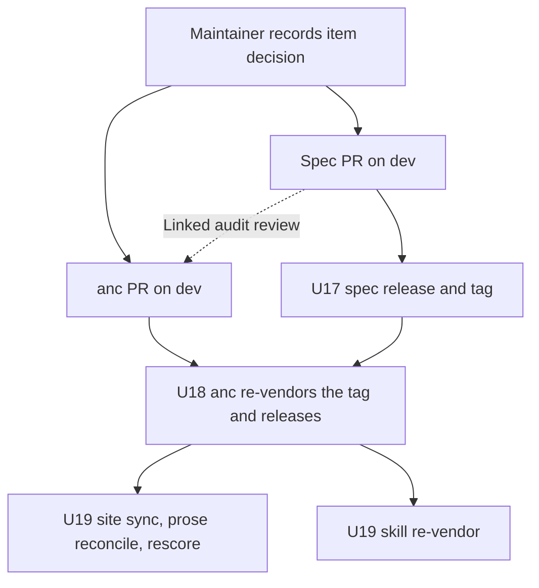

# anc v0.7.0 Spec Alignment - Plan

**Target repos:** `brettdavies/agentnative` (the spec, this repo) and `brettdavies/agentnative-cli` (anc). Unprefixed
paths are in this repo; `cli:` paths are in agentnative-cli.

## Goal Capsule

- **Objective:** for each of the eight items below, the standard's text and anc's grade give the same verdict for the
  same tool, and the standard no longer contradicts itself, so a tool author who reads the spec, an `anc audit`
  scorecard, and anc.dev reaches one answer.
- **Means:** the maintainer records each item's direction in Key Decisions; each chosen side lands as one spec PR paired
  with one anc PR (KTD1); a spec tag precedes the anc release that vendors it (KTD2).
- **Authority:** the maintainer's per-item decisions outrank this plan's recommendations. The spec's `CONTRIBUTING.md`
  and `RELEASES.md` govern spec PRs and releases; agentnative-cli's `AGENTS.md` and `RELEASES.md` govern anc work. This
  plan governs scope and sequencing.
- **Execution profile:** one `fix/` branch per repo per decided item, cut from that repo's `dev` in a standalone clone.
  U17 to U19 run once, after every decided item's PRs merge.
- **Stop conditions:**
  - An item's decision reads `pending`: skip that item's units.
  - Evidence contradicts an item's recorded decision, such as a tool its Example line names getting a different verdict
    than the item states: stop and report before opening the PR.
  - Any step that merges a PR, tags, or publishes: stop. Those are the maintainer's acts.
- **Who finishes:** the maintainer merges each paired PR into `dev` in both repos, merges the spec release PR (U17), and
  runs anc's release (U18). U19's downstream syncs follow anc's release.

---

## Product Contract

### Summary

Close eight places where spec v0.7.0 and anc v0.7.0 disagree, or where the spec disagrees with itself. Each item below
carries its evidence, the ways to close it, and a recommendation. The maintainer chooses per item, and only the units
for the chosen side run. No spec or anc text changes until a choice is recorded.

### Problem Frame

anc v0.7.0 credits flags, exemptions, and declarations that the spec text does not name, and in two places the spec's
own text points two ways. A tool can pass a MUST in anc that a reader of the spec would fail, or the reverse, and
anc.dev then shows principle pages and scorecards that disagree.

All the anc behavior below shipped in v0.7.0 (2026-10-27) or earlier, most of it in cli#143, #147, #195, #196, and #197.
anc v0.7.0 vendors spec 0.6.0, and anc `dev` vendors 0.7.0 (cli#254). The spec's single-letter reading rule (#59) and
anc's opposite letter rule (cli#197) merged 18 minutes apart on 2026-10-26.

### Requirements

**Agreement per item**

- R1. P2 and P4 text and anc agree on which flags select JSON output and on when the JSON error contract applies (item
  1).
- R2. P5 text and anc agree on which operations need a confirmation flag (item 2).
- R3. P3 text and anc agree on which prefixed command-list line is the bare invocation (item 3).
- R4. The spec's flag-name reading rule, P5's other-name clause, and anc agree on when a single-letter flag meets a
  requirement (item 4).
- R5. P7 and P6 text and anc agree on the names that meet the limit, timeout, and cursor-pagination requirements, and on
  where the P7 timeout requirement applies (item 5).
- R6. `p8-should-bundle-exists` gets one verdict per scorecard, and every audit anc groups under a principle covers a
  requirement of that principle (item 6).
- R7. `p1-should-tty-detection` names one stream across its summary, prose, and examples, and the audit that covers it
  checks that requirement (item 7).
- R8. P1 text and anc agree on which tools `p1-must-no-browser` applies to and which flags meet it (item 8).

**Delivery**

- R9. Every spec PR that changes a requirement names the anc PR that grades it in its Linked audit review section.
- R10. A released anc never grades requirement text that no spec tag carries.
- R11. After anc's release, agentnative-site and agentnative-skill vendor the new spec tag, the site's principle copy is
  reconciled to it, and the site's registry scorecards are regenerated with the released anc.

### Key Decisions

- **Spec v0.7.0 shipped before these gaps closed.** (session-settled: user-directed — chosen over holding v0.7.0 until
  they closed: the release carried #58's fixes, which anc already graded.) Governs R10.
- **Each item's direction is the maintainer's choice.** (session-settled: user-directed — chosen over this plan fixing
  one direction: each item trades strictness against credit for tools agents already use.) Governs R1-R8.
- **Recommendations favor what an agent relies on, not the cheaper change.** (session-settled: user-approved — proposed
  with the scope and confirmed.) Governs R1-R8.
- **Item decisions.** Option letters are defined per item in Item Evidence and Options. Governs R1-R8.

| Item                                            | Recommended | Decision |
| ----------------------------------------------- | ----------- | -------- |
| 1. JSON output flags and the JSON error trigger | C           | pending  |
| 2. What counts as destructive                   | C           | pending  |
| 3. Default-command lines with placeholders      | C           | pending  |
| 4. Single-letter flags                          | A           | pending  |
| 5a. Limit names                                 | C           | pending  |
| 5b. Timeout names and scope                     | C           | pending  |
| 5c. Cursor-pagination names                     | C           | pending  |
| 6. `p6-agents-md`                               | B           | pending  |
| 7. TTY-detection stream                         | A + B1      | pending  |
| 8. Headless authentication scope                | C           | pending  |

### Scope Boundaries

- No spec or anc text changes for an item whose decision is `pending`.
- Site and skill work is limited to the re-vendor, prose reconciliation, and rescore in U19.
- No requirement `id` is added, renamed, or removed (KTD4).
- Considered and not built: restricting `[p5] not_destructive` to a project's own `.anc.toml`. anc's scorecard schema
  documents the user-level `~/.anc.toml` as a supported scope (`config_hint.files`, scope `user`), and item 2's
  structured waiver field makes every waiver visible whichever file supplied it. A waiver applied from a third party's
  home directory to a registry score would change that call.
- Considered and not built: a spec-wide rule that any documented equivalent meets any named flag. Items 1, 4, and 5
  settle the cases anc grades; a blanket rule would also loosen requirements anc does not grade by name.

---

## Item Evidence and Options

### Item 1. JSON output flags and the JSON error trigger

- **Spec:** `p2-must-output-flag` (MUST) reads "Structured-output CLIs MUST offer at least one machine-readable format
  selectable via `--output`", and `p2-should-json-aliases` lets `--json` and `--jsonl` meet it through the alias path
  (`principles/p2-structured-parseable-output.md`). `p2-must-json-errors` (MUST) and `p4-should-json-error-output`
  (SHOULD) apply "When `--output json` is active". `p2-should-consistent-envelope` names no flag.
- **anc:** `p2-json-output` also credits `--format` by name alone (since v0.1.0) and `--output-format` when its
  definition names `json` (cli#195) (`cli:src/audits/behavioral/output_flags.rs`). The three error audits
  (`p2-json-errors`, `p4-json-error-output`, `p2-consistent-envelope`) run under any JSON mode the top-level help
  declares (cli#196), and read only the top-level help.
- **Example:** rg declares only `--json`, shellcheck declares `--format` with `json` among its values, and yq declares
  `--output-format`. None of them ever has `--output json` active, yet anc grades rg's and shellcheck's JSON errors
  (rg's `p2-must-json-errors` moved from skip to fail). A tool whose `--output json` exists only on subcommands, the gh
  and kubectl shape, gets `skip` on all three error rows.
- **Options:**
  - A. Spec: an output-format option under another name meets `p2-must-output-flag` when its definition names `json`,
    with `--output` canonical; the error and envelope requirements apply whenever a JSON output mode is active.
  - B. anc: credit only `--output` and the aliases, and run the error audits only under `--output json` or an alias.
    shellcheck and yq drop to `opt_out` on the MUST.
  - C. A, plus anc holds `--format` to the same names-json test as `--output-format` and looks for a JSON mode in
    subcommand help when the top-level help declares none, as `p2-json-output` already does.
- **Recommendation: C.** An agent selects JSON with whatever flag the help documents and then parses errors under that
  same mode, so a requirement keyed to one spelling misses tools agents already drive this way. C also closes two loose
  ends in anc: a Go-template `--format` counted by name, and subcommand-only JSON tools skipped.

### Item 2. What counts as destructive

- **Spec:** `p5-must-force-yes` (MUST, if the CLI has destructive operations) reads "Destructive operations (delete,
  overwrite, bulk modify) MUST require an explicit confirmation flag." That parenthetical is the only definition of
  destructive, and P5 has no declaration or exclusion. #58 changed only the confirmation-flag wording.
- **anc:** `.anc.toml [p5] not_destructive` (cli#147) removes listed subcommands from `p5-force-yes`'s destructive set,
  which anc detects by name (`delete`, `remove`, `rm`, `destroy`, `purge`, `wipe`, `reset`, `drop`, `clean`, `force-`).
  An entry that is not lowercase or names no listed subcommand is accepted silently, and so is `delete`. The waiver
  appears only in the row's evidence prose.
- **Example:** biome declares `not_destructive = ["clean"]` and its `p5-force-yes` row reads `skip`. A tool can declare
  `["delete"]` the same way, while by the spec its `delete` still needs a confirmation flag.
- **Options:**
  - A. Spec: define a destructive operation by its effect: it deletes or overwrites data the tool cannot regenerate, or
    modifies many records at once. Clearing data the tool rebuilds on demand, such as a cache, is not destructive.
  - B. anc: drop `not_destructive`, so every name-detected subcommand needs a confirmation flag. biome's `clean` fails.
  - C. A, plus anc warns on an entry that is not lowercase or names no listed subcommand, and records each waiver in a
    structured scorecard field.
- **Recommendation: C.** The confirmation gate exists so one call cannot lose data an agent needs, and a cache clear
  loses none. anc's name list cannot tell the two apart, so the author's declaration carries the definition, and the
  structured field shows every reader what was waived.

### Item 3. Default-command lines with placeholders

- **Spec:** `p3-should-unprefixed-command-list` (SHOULD, if the CLI uses subcommands) reads "The bare invocation line,
  which documents what the tool does with no arguments, is the one entry that legitimately carries the binary name
  alone." P3 has no placeholder exemption.
- **anc:** `p3-unprefixed-command-list` also exempts a prefixed line whose remaining words all start with `[` or `<`
  (cli#143). An uppercase metavariable still warns.
- **Example:** `opencode [project]   start opencode tui` and `gemini [query..]` pass anc and fail the spec's wording,
  while `tool FILE   Open a file` warns in anc although it has the same default-command shape.
- **Options:**
  - A. Spec: the bare-invocation entry may add argument placeholders (`[project]`, `<path>`, `FILE`) and still carries
    the binary name legitimately.
  - B. anc: drop the placeholder exemption. opencode and gemini warn.
  - C. A, plus anc treats an all-caps metavariable as a placeholder.
- **Recommendation: C.** The rule lets an agent lift command tokens from the left column, and a default-invocation line
  names no command token whether or not it adds placeholders. C makes anc's placeholder test match the forms help text
  uses.

### Item 4. Single-letter flags

- **Spec:** the reading rule in `README.md` § Reading the spec (#59) says "A single letter is a different name in either
  case and meets only a requirement that names that letter". anc vendors `principles/` and not the README, so the rule
  never reaches anc's copy. P5's `p5-must-force-yes` says a flag under another name meets it "when the command's
  `--help` documents it as the flag that confirms the operation without a prompt", which reads on
  `-y  Skip confirmation prompts`. The spec names `-v` for both verbose (`p7-should-verbose`) and version
  (`p3-should-version-short`).
- **anc:** since cli#197, a letter counts when its own definition means what the audit asks for, through an accepted
  long name on the same line or a description word (`cli:src/audits/behavioral/flag_meaning.rs`). It credits letters
  this way for `p7-must-quiet` (`-q`), `p7-should-limit` (`-n`), `p7-should-verbose` (`-v`), `p5-must-force-yes` (`-y`,
  `-f`), and `p1-must-no-interactive` (`-y`, `-p`); on anc `dev`, cli#259 adds `p3-should-version-short`. A letter with
  no description does not count, even where the requirement names it. anc's vendored `cli:src/principles/spec/README.md`
  on `dev` says the audits read help "by the same rule" as the spec.
- **Example:** unzip's `-q  quiet mode`, with no `--quiet`, passes `p7-must-quiet` in anc and fails it under the spec
  rule. A lone `-v` with no description meets the spec's name test for both verbose and version.
- **Options:**
  - A. Spec: a single letter meets a requirement when its help definition states that requirement's meaning, through a
    long name the requirement accepts on the same line or a description that names the meaning. The same test applies to
    a letter the requirement names, because one letter can carry two meanings. The rule moves to a file anc vendors
    (KTD6).
  - B. anc: credit a letter only for a requirement that names it, dropping `-q`, `-n`, `-y`, `-f`, and `-p`, and the
    spec rewords P5's other-name clause to exclude letters. unzip-style tools fail `p7-must-quiet`, and a lone `-v`
    passes verbose.
- **Recommendation: A.** An agent learns what a letter does from its definition, and P5 already accepts documented
  equivalents. The definition test tells verbose `-v` from version `-v`, which the name test cannot. A matches anc's
  shipped behavior. It reverses part of #59, which the maintainer merged on 2026-10-26.

### Item 5. Limit, timeout, and cursor-pagination names

- **Spec:** `p7-should-limit` names `--limit` and `--max-results`. `p7-should-timeout` (SHOULD, universal) names
  `--timeout`, as does `p6-must-timeout-network` (MUST, if the CLI makes network calls). `p7-may-cursor-pagination`
  names `--after` and `--before`. No spec version has named the extra flags below.
- **anc (since v0.5.0, cli#55 and #56):** `p7-limit` accepts `--max` and `--top` by name and `-n` by meaning.
  `p7-timeout-behavioral` accepts `--deadline` and `--max-time`, and runs only when a subcommand name reads as
  long-running (`serve`, `daemon`, `watch`, `tail`, `monitor`, `follow`, `run`, `start`, `stream`).
  `p7-cursor-pagination` accepts `--cursor`, `--page`, and `--offset`.
- **Example:** helm's `list --max` passes the limit audit and its `--offset` passes cursor pagination. A `watch`
  subcommand with only `--max-time` passes the timeout audit. A tool with no long-running subcommand is never graded on
  `p7-should-timeout`, though the spec applies it to every CLI.
- **Options and recommendations:**
  - 5a, limit. A: the spec accepts an option whose definition bounds the number of items returned (`--max`, `--top`,
    `-n`), with `--limit` canonical. B: anc drops `--max`, `--top`, and `-n`. C: A, plus anc applies its definition test
    to `--max` and `--top` as it does to `-n`. **Recommendation: C.**
  - 5b, timeout. A: `p7-should-timeout` and `p6-must-timeout-network` accept documented equivalents (`--deadline`,
    `--max-time`), and `p7-should-timeout` applies to commands that can run unbounded (servers, watchers, streams),
    leaving network calls to `p6-must-timeout-network`. B: anc drops the two names and runs `p7-timeout-behavioral` on
    every tool. C: A, plus anc's long-running gate becomes the documented applicability. **Recommendation: C.**
  - 5c, cursor pagination. A: the spec names `--cursor` beside `--after` and `--before`. B: anc stops crediting `--page`
    and `--offset`. C: both. **Recommendation: C.**
- **Reason:** agents bound result size and run time with whatever the help documents, so the documented names belong in
  the text. Positional paging drifts when results change between calls, which is the failure cursor pagination exists to
  prevent, so `--page` and `--offset` do not meet it.

### Item 6. `p6-agents-md`

- **Spec:** `p6-agents-md` appears nowhere in spec 0.7.0, because #58 removed it from P6's audit list.
  `principles/AGENTS.md` says "The verifier emits one result entry per requirement row". `p8-should-bundle-exists`
  (SHOULD) asks for a top-level `AGENTS.md` or `SKILL.md` with frontmatter.
- **anc:** `p6-agents-md` (project layer, grouped under P6) covers `p8-should-bundle-exists` and checks only that
  `AGENTS.md` exists. `p8-bundle-exists` covers the same requirement, accepting `AGENTS.md` or `SKILL.md` with
  frontmatter. A source audit therefore emits two rows for the requirement, and they can disagree.
  `anc emit coverage-matrix` titles the P8 section "P8: Unknown".
- **Example:** a repo with only `SKILL.md` gets `warn` from `p6-agents-md` under `--principle 6` and `pass` from
  `p8-bundle-exists` under `--principle 8`, both as rows for `p8-should-bundle-exists`.
- **Options:**
  - A. Spec: list `p6-agents-md` among P8's audit IDs, keeping two verifiers.
  - B. anc: retire `p6-agents-md` so `p8-bundle-exists` is the one verifier, and name the P8 section.
  - C. anc regroups `p6-agents-md` under P8, and the spec lists it there.
- **Recommendation: B.** `p8-bundle-exists` checks everything `p6-agents-md` does and more, so the second row only adds
  a contradicting verdict. Spec 0.7.0 already matches B, which leaves the work to anc alone.

### Item 7. TTY-detection stream

- **Spec:** `p1-should-tty-detection` (SHOULD) names stderr in its summary ("suppress prompts when stderr is not a
  terminal"), stdin in its prose ("TTY detection on stdin (and stderr, where prompts target it)"), and stdout in its
  Python example (`sys.stdout.isatty()`). The prose says these entry points "appear in the Evidence section", which
  lists none of them. `p1-must-no-interactive` applies "When stdin is not a terminal".
- **anc:** `p1-tty-detection-source` (Rust source, labeled "TTY detection for color output") covers
  `p1-should-tty-detection`. It triggers on color code and passes on any `is_terminal` or `atty` substring, whatever the
  stream, which is the TTY half of `p6-must-no-color` ("color codes suppressed when stdout/stderr is not a terminal"),
  not prompt handling.
- **Options:**
  - A, spec, needed under every decision: the requirement names stdin as the detection stream, plus stderr where a
    prompt renders there. The summary, prose, and examples agree (`sys.stdin.isatty()`), and the Evidence section lists
    the entry points the prose cites.
  - B1, anc: re-point `p1-tty-detection-source` to cover `p6-must-no-color`, the requirement it checks.
  - B2, anc: rework the audit to find prompt calls guarded by a stdin TTY check.
- **Recommendation: A with B1.** Prompts read stdin, and the MUST beside this SHOULD already keys on stdin. The color
  audit verifies a real requirement, just not this one. Source-layer rows do not enter the score, so B1 changes coverage
  reporting only.

### Item 8. Headless authentication scope

- **Spec:** `p1-must-no-browser` (MUST, if the CLI authenticates against a remote service) asks for "A headless
  authentication path if the CLI authenticates", with `--no-browser` canonical and `--device-code`, `--remote`, and
  `--headless` acceptable. It never says whether a tool whose only credential is an API key or token meets it, and a
  [wontfix] pressure-test note calls service-account auth "orthogonal".
- **anc:** `p1-headless-auth` (Rust source only, outside the score) warns when a function name holds an auth keyword and
  no file with an `#[arg]` attribute contains "no-browser" or "headless". It does not credit `--device-code` or
  `--remote`.
- **Example:** an API-key tool with `fn authorization_header()` gets `warn`, and the same tool with `fn api_key()` gets
  `skip`. A browser-only OAuth tool with an unrelated `--headless` rendering flag gets `pass`.
- **Options:**
  - A. Spec: the requirement applies to tools that authenticate through a browser-based flow. A tool whose only
    credentials are static (an API key or token from the environment or a file) has no browser to avoid, and
    `p1-must-secret-non-leaky-path` governs how it reads them.
  - A2. Spec: a static-credential path counts as headless, so the requirement still applies to every authenticating tool
    and API-key tools pass.
  - B. anc only: credit `--device-code` and `--remote`, and require the flag text on an argument definition rather than
    anywhere in the file.
  - C. A plus B, with anc triggering on code that opens a browser rather than on auth-like function names.
- **Recommendation: C.** The MUST exists because an agent cannot click through a browser, and an API-key tool never asks
  it to, so not applicable is the true verdict for that tool. anc should look for the browser launch the requirement is
  about.

---

## Planning Contract

### Key Technical Decisions

- KTD1. **One spec PR and one anc PR per decided item.** Each spec PR names its anc PR in Linked audit review (R9), so
  every PR carries one decision. Chosen over one spec PR for all items, because a combined PR would let one contested
  item hold the rest.
- KTD2. **Spec tag before anc release.** Paired PRs merge to each repo's `dev` in either order. U17 tags the spec, then
  U18 re-vendors that tag and releases anc. This order is R10's mechanism: anc v0.7.0 shipped first and graded text no
  tag carried.
- KTD3. **The release version follows the highest tier changed.** Per `CONTRIBUTING.md`, any decided change to a MUST
  (items 1, 2, and 8 in their spec options, and item 4 B through P5's clause) makes the release 0.8.0. A release with
  only SHOULD, MAY, or prose changes is 0.7.1.
- KTD4. **Requirements are reworded, never re-identified.** Consumers pin frontmatter ids, so text, accepted names, and
  applicability change while ids stay. Each touched principle bumps `last-revised` per `principles/AGENTS.md`.
- KTD5. **anc's pending release is not held for this plan.** anc `dev` already vendors spec 0.7.0 (cli#254) and can
  release before any item here is decided, so the site's scorecards reach 0.7.0 sooner. This plan's anc changes ride a
  later release.
- KTD6. **The flag-name reading rule moves under `principles/`.** anc vendors `principles/*.md` and
  `principles/scoring.md`, so only a rule in one of those files reaches anc's vendored copy. U7 picks the file and
  leaves the README pointing to it.

### High-Level Technical Design

Each decided item flows through the same chain; the per-item units differ only in which repo changes.

Which units run for each decision:

| Item       | A             | B                   | C           |
| ---------- | ------------- | ------------------- | ----------- |
| 1          | U1            | U2                  | U1, U2      |
| 2          | U3            | U4                  | U3, U4      |
| 3          | U5            | U6                  | U5, U6      |
| 4          | U7            | U7, U8              | not offered |
| 5a, 5b, 5c | U9            | U10                 | U9, U10     |
| 6          | U11           | U12                 | U11, U12    |
| 7          | U13           | U13, U14 (B1 or B2) | not offered |
| 8          | U15 (A or A2) | U16                 | U15, U16    |

### Risks & Dependencies

- `docs/plans/2026-04-29-001-feat-p2-p4-output-envelope-shoulds-plan.md` (proposed) rewrites
  `p2-should-consistent-envelope` and `p4-should-json-error-output`, the requirements U1 re-triggers. Whichever lands
  second rebases its wording on the first.
- B options and anc tightenings move real tools' rows: shellcheck and yq (item 1 B), biome (item 2 B), unzip (item 4 B),
  helm (items 5a B and 5c). Each anc PR body lists the rows it moves; U19's rescore publishes them.
- Item 4 A reverses part of #59, three days after it merged. The spec PR names #59 and states the conflict with P5's
  clause and the double `-v`.
- anc's pending release (KTD5) and U18 both re-vendor the spec. If anc has not released by U18, U18's release carries
  both.

---

## Implementation Units

| U-ID | Title                                     | Repo        | Runs when          | Depends on                      |
| ---- | ----------------------------------------- | ----------- | ------------------ | ------------------------------- |
| U1   | JSON output flags in P2 and P4            | spec        | item 1 A or C      | decision                        |
| U2   | JSON output flags in anc                  | cli         | item 1 B or C      | decision                        |
| U3   | Destructive defined by effect in P5       | spec        | item 2 A or C      | decision                        |
| U4   | `not_destructive` in anc                  | cli         | item 2 B or C      | decision                        |
| U5   | Placeholder default lines in P3           | spec        | item 3 A or C      | decision                        |
| U6   | Placeholder default lines in anc          | cli         | item 3 B or C      | decision                        |
| U7   | Single-letter reading rule                | spec        | item 4 any         | decision                        |
| U8   | Single-letter crediting in anc            | cli         | item 4 any         | decision                        |
| U9   | Limit, timeout, cursor names in P6 and P7 | spec        | 5a/5b/5c A or C    | decision                        |
| U10  | Limit, timeout, cursor names in anc       | cli         | 5a/5b/5c B or C    | decision                        |
| U11  | `p6-agents-md` in P8's audit list         | spec        | item 6 A or C      | decision                        |
| U12  | `p6-agents-md` in anc                     | cli         | item 6 B or C      | decision                        |
| U13  | TTY-detection stream in P1                | spec        | item 7 any         | decision                        |
| U14  | TTY-detection coverage in anc             | cli         | item 7 B1 or B2    | decision                        |
| U15  | Headless-auth scope in P1                 | spec        | item 8 A, A2, or C | decision                        |
| U16  | Headless-auth audit in anc                | cli         | item 8 B or C      | decision                        |
| U17  | Spec release                              | spec        | once               | every decided item's PRs merged |
| U18  | anc re-vendor and release                 | cli         | once               | U17                             |
| U19  | Site and skill sync                       | site, skill | once               | U18                             |

Every spec unit's PR fills the spec PR template, including Linked audit review (R9), and its `## Changelog` entry is the
user-facing line. Every anc unit's PR body lists each real-tool row it moves.

### U1. JSON output flags in P2 and P4

- **Goal:** P2 and P4 name every flag that selects JSON and apply the error contract under any of them.
- **Requirements:** R1, R9; KTD1, KTD4.
- **Dependencies:** item 1 decision; for C, U2's PR exists so its URL goes in Linked audit review.
- **Files:** `principles/p2-structured-parseable-output.md`, `principles/p4-fail-fast-actionable-errors.md`.
- **Approach:**
  1. `p2-must-output-flag` summary, prose, and Evidence: an output-format option under another name meets the MUST when
     its definition names `json`; `--output` stays canonical.
  2. State once, in P2, what "a JSON output mode is active" means (`--output json`, a `--json` or `--jsonl` alias, or
     such an option), and make `p2-must-json-errors` and `p4-should-json-error-output` apply under it; P4 cites P2
     rather than restating the list.
  3. Bump `last-revised` in both files.
- **Test expectation:** none -- prose and frontmatter. `validate-principles` and `check-last-revised` in the pre-push
  hook gate the change.
- **Verification:** reading P2 alone, a reviewer can say whether rg, shellcheck, and yq meet `p2-must-output-flag`, and
  whether each one's JSON errors are graded.

### U2. JSON output flags in anc

- **Goal:** anc credits the flags and modes item 1's decision names, and no others.
- **Requirements:** R1; KTD1.
- **Dependencies:** item 1 decision.
- **Files:** `cli:src/audits/behavioral/output_flags.rs`, `cli:src/audits/behavioral/json_output.rs`,
  `cli:src/audits/behavioral/error_probe.rs`, `cli:src/audits/behavioral/json_errors.rs`,
  `cli:src/audits/behavioral/json_error_output.rs`, `cli:src/audits/behavioral/consistent_envelope.rs`, `cli:README.md`.
- **Approach:**
  - Under C: `--format` joins `--output-format` in the names-json list; `json_mode` reads top-level subcommands' help
    when the top-level help declares no JSON mode, using the search `p2-json-output` already does, and probes that
    subcommand.
  - Under B: the accepted output flag is `--output` plus the boolean aliases, and `json_mode` returns only those.
  - The README `json_probe` paragraph names the accepted flags as the decision states them.
- **Test scenarios:**
  - C: `--format <F>  Output format (text, json)` yields JSON mode `--format json`.
  - C: `--format <TEMPLATE>  Go template for output` is not an output flag, and `p2-json-output` reads `opt_out`.
  - C: a top-level help with no JSON mode and a `list` subcommand declaring `--output <FMT>  json|text` puts all three
    error audits on `list` with `--output json`, not `skip`.
  - B: shellcheck's help gives `p2-json-output` `opt_out` and the error audits `skip` with the no-JSON-mode reason.
  - Either: rg's boolean `--json` still selects JSON through the alias path.
- **Verification:** the CLI pre-push gate passes, and the PR body's table lists the moved rows for rg, shellcheck, yq,
  and a subcommand-only tool.

### U3. Destructive defined by effect in P5

- **Goal:** P5 defines a destructive operation by what it does, so a cache clear is outside `p5-must-force-yes`.
- **Requirements:** R2, R9; KTD3, KTD4.
- **Dependencies:** item 2 decision.
- **Files:** `principles/p5-safe-retries-mutation-boundaries.md`.
- **Approach:** the Definition paragraph and the MUST's summary and prose define destructive by effect, as item 2 A
  states, and the Evidence line follows; the anti-pattern about an immediate `delete` stays. Bump `last-revised`.
- **Test expectation:** none -- prose and frontmatter; the pre-push validators gate it.
- **Verification:** from P5 alone, a reviewer can say that biome's cache `clean` is not destructive and that a `delete`
  of user records is.

### U4. `not_destructive` in anc

- **Goal:** every `not_destructive` waiver is valid and visible, or the setting is gone, per item 2's decision.
- **Requirements:** R2; KTD1.
- **Dependencies:** item 2 decision.
- **Files:** `cli:src/anc_toml/settings.rs`, `cli:src/anc_toml/mod.rs`, `cli:src/audits/behavioral/force_yes.rs`,
  `cli:src/scorecard/mod.rs`, `cli:README.md`.
- **Approach:**
  - Under C: an entry that is not lowercase, or names no subcommand the help lists, produces a warning in the row's
    evidence and is not applied. Each applied waiver appears in a structured row field naming the subcommand and the
    file that supplied it, beside the existing evidence text; the scorecard schema version moves with the new field.
  - Under B: the setting is removed, its README section goes, and an `.anc.toml` that still carries it is read with the
    key ignored, as unknown keys already are.
- **Test scenarios:**
  - C: `not_destructive = ["Clean"]` with a `clean` subcommand leaves `clean` in the destructive set and names the
    casing in evidence.
  - C: `not_destructive = ["purge"]` with no `purge` subcommand warns that the entry matches nothing.
  - C: `not_destructive = ["clean"]` on biome's help gives `skip`, and the row carries the structured waiver naming
    `clean` and `.anc.toml`.
  - B: biome's help with the same file gives `p5-force-yes` `fail` for `clean`.
- **Verification:** the CLI pre-push gate passes; under C, the new field appears in `anc audit --output json` for the
  biome case.

### U5. Placeholder default lines in P3

- **Goal:** P3's bare-invocation exemption covers a default-command line with argument placeholders.
- **Requirements:** R3, R9; KTD4.
- **Dependencies:** item 3 decision.
- **Files:** `principles/p3-progressive-help-discovery.md`.
- **Approach:** the bare-invocation sentence admits argument placeholders written as `[x]`, `<x>`, or an all-caps
  metavariable. Bump `last-revised`.
- **Test expectation:** none -- prose and frontmatter; the pre-push validators gate it.
- **Verification:** from P3 alone, `opencode [project]` is the exempt entry and `opencode run [message..]` is not.

### U6. Placeholder default lines in anc

- **Goal:** anc's placeholder test matches item 3's decision.
- **Requirements:** R3; KTD1.
- **Dependencies:** item 3 decision.
- **Files:** `cli:src/audits/behavioral/unprefixed_command_list.rs`.
- **Approach:**
  - Under C: `is_bare_invocation` also counts an all-caps metavariable token as a placeholder.
  - Under B: `is_bare_invocation` is true only for an empty remainder.
- **Test scenarios:**
  - C: `tool FILE   Open a file` in a prefixed block is not an offender.
  - C: `tool run FILE   Run a file` is an offender, because `run` names a command.
  - B: opencode 1.18's help warns on `opencode [project]`.
  - Either: herdr's bare `herdr` line is not an offender.
- **Verification:** the CLI pre-push gate passes.

### U7. Single-letter reading rule

- **Goal:** one reading rule for flag names lives where anc vendors it and agrees with P5.
- **Requirements:** R4, R9; KTD3, KTD6.
- **Dependencies:** item 4 decision.
- **Files:** `README.md`, the chosen file under `principles/`, `principles/p5-safe-retries-mutation-boundaries.md` (B
  only).
- **Approach:**
  1. Move the § Reading the spec rule into a file under `principles/` that anc vendors; the README keeps a one-line
     pointer.
  2. Under A: the single-letter sentence becomes the definition test item 4 A states, and names the double `-v` as the
     reason it covers named letters.
  3. Under B: the rule keeps its wording, and P5's other-name clause says a single letter meets `p5-must-force-yes` only
     where the requirement names it. Bump P5's `last-revised`.
- **Test expectation:** none -- prose; the pre-push link check and validators gate it.
- **Verification:** one rule governs letters across the spec, and `-y  Skip confirmation prompts` gets the same verdict
  from the rule and from P5.

### U8. Single-letter crediting in anc

- **Goal:** anc's letter crediting and its vendored README state the decided rule.
- **Requirements:** R4; KTD1.
- **Dependencies:** item 4 decision.
- **Files:** `cli:src/principles/spec/README.md`, `cli:README.md`; under B also
  `cli:src/audits/behavioral/flag_meaning.rs` and the audits that list letters (`quiet.rs`, `limit_flag.rs`,
  `verbose_flag.rs`, `force_yes.rs`, `non_interactive.rs`, `flag_existence.rs`, `version.rs`).
- **Approach:**
  - Under A: no audit change. The vendored README's sentence names the file the rule moved to, and the CLI README's
    letter paragraph cites it.
  - Under B: a letter counts only for an audit whose requirement names it (`-v`, `-vv`, `-V`); the other letters leave
    the accepted lists.
- **Test scenarios:**
  - A: test expectation: none -- documentation only.
  - B: unzip's `-q  quiet mode` gives `p7-quiet` `warn`.
  - B: `-y  Skip confirmation prompts.` on a destructive subcommand gives `p5-force-yes` `fail`.
  - B: a lone `-v` with no description passes `p7-verbose`.
- **Verification:** the CLI pre-push gate passes, and the vendored README's claim matches the audits.

### U9. Limit, timeout, cursor names in P6 and P7

- **Goal:** P6 and P7 name the flags and scope items 5a to 5c decide.
- **Requirements:** R5, R9; KTD3, KTD4.
- **Dependencies:** items 5a, 5b, 5c decisions.
- **Files:** `principles/p7-bounded-high-signal-responses.md`,
  `principles/p6-composable-predictable-command-structure.md` (5b only).
- **Approach:**
  - 5a: `p7-should-limit` accepts an option whose definition bounds the item count, with `--limit` canonical.
  - 5b: `p7-should-timeout` and `p6-must-timeout-network` accept `--deadline` and `--max-time` as documented
    equivalents, and `p7-should-timeout`'s applicability becomes commands that can run unbounded.
  - 5c: `p7-may-cursor-pagination` names `--cursor`.
  - Bump `last-revised` in each touched file.
- **Test expectation:** none -- prose and frontmatter; `validate-principles` checks the applicability shape.
- **Verification:** from P7 alone, helm's `list --max` meets the limit SHOULD and its `--offset` does not meet cursor
  pagination.

### U10. Limit, timeout, cursor names in anc

- **Goal:** anc's accepted names and gates match items 5a to 5c.
- **Requirements:** R5; KTD1.
- **Dependencies:** items 5a, 5b, 5c decisions.
- **Files:** `cli:src/audits/behavioral/limit_flag.rs`, `cli:src/audits/behavioral/timeout_behavioral.rs`,
  `cli:src/audits/behavioral/cursor_pagination.rs`.
- **Approach:**
  - 5a C: `--max` and `--top` pass `flag_meaning`'s definition test, as `-n` does. 5a B: they and `-n` leave the list.
  - 5b C: the long-running gate stays and its doc comment cites the requirement's applicability. 5b B: the two names
    leave the list and the gate goes.
  - 5c B or C: `--page` and `--offset` leave the list, and the module doc lists the accepted names.
- **Test scenarios:**
  - 5a C: helm's `-m, --max int  maximum number of releases to fetch` passes; `--max <DEPTH>  Maximum directory depth`
    does not.
  - 5c: helm's `--offset int` on `list` gives `p7-cursor-pagination` no credit.
  - 5c: `--cursor <TOKEN>` on a list subcommand still passes.
  - 5b B: a tool with no long-running subcommand and no `--timeout` gets `warn`.
- **Verification:** the CLI pre-push gate passes.

### U11. `p6-agents-md` in P8's audit list

- **Goal:** P8's audit-ID line names `p6-agents-md`, when item 6 keeps the audit.
- **Requirements:** R6, R9.
- **Dependencies:** item 6 decision.
- **Files:** `principles/p8-discoverable-skill-bundle.md`.
- **Approach:** add the audit ID to P8's measured-by line (under C, after U12 renames or regroups it).
- **Test expectation:** none -- prose.
- **Verification:** every audit ID that covers a P8 requirement appears on P8's line.

### U12. `p6-agents-md` in anc

- **Goal:** `p8-should-bundle-exists` gets one row, or two rows under P8, per item 6's decision, and the coverage matrix
  names P8.
- **Requirements:** R6; KTD1.
- **Dependencies:** item 6 decision.
- **Files:** `cli:src/audits/project/agents_md.rs`, `cli:src/audits/project/mod.rs`, `cli:src/principles/matrix.rs`,
  `cli:docs/coverage-matrix.md`, `cli:coverage/matrix.json`, `cli:README.md`.
- **Approach:**
  - Under B: remove `p6-agents-md` from the registry and the README's P6 row.
  - Under C: group it under P8.
  - Either: `principle_name` names P8, and the coverage artifacts are regenerated with `anc emit coverage-matrix`.
- **Test scenarios:**
  - B: a repo with only `SKILL.md` and frontmatter gets one `p8-should-bundle-exists` row, `pass`.
  - B or C: `anc audit --principle 6` on that repo emits no `p8-should-bundle-exists` row.
  - Either: the coverage matrix's P8 heading carries the principle's name.
- **Verification:** the CLI pre-push gate passes, including the integration test that runs the coverage-matrix check
  against the committed artifacts.

### U13. TTY-detection stream in P1

- **Goal:** `p1-should-tty-detection` names stdin, plus stderr where a prompt renders there, in every place it states
  the rule.
- **Requirements:** R7, R9; KTD4.
- **Dependencies:** item 7 decision.
- **Files:** `principles/p1-non-interactive-by-default.md`.
- **Approach:** the summary, prose, and examples name the same streams (`sys.stdin.isatty()` in the Python example); the
  Evidence section lists the entry points the prose cites. Bump `last-revised`, since the summary changes.
- **Test expectation:** none -- prose and frontmatter; the pre-push validators gate it.
- **Verification:** the summary, prose, and examples of the requirement name the same stream.

### U14. TTY-detection coverage in anc

- **Goal:** the audit that covers `p1-should-tty-detection` checks it, or the color audit covers the color requirement,
  per item 7's decision.
- **Requirements:** R7; KTD1.
- **Dependencies:** item 7 decision; U13's wording for B2.
- **Files:** `cli:src/audits/source/rust/tty_detection.rs`, `cli:docs/coverage-matrix.md`, `cli:coverage/matrix.json`.
- **Approach:**
  - B1: `covers()` names `p6-must-no-color`, and the audit's group moves to P6.
  - B2: the trigger becomes a prompt-library call, and the pass needs a TTY check on stdin.
  - Either: regenerate the coverage artifacts.
- **Test scenarios:**
  - B1: the coverage matrix lists `p1-tty-detection-source` under `p6-must-no-color` and not under
    `p1-should-tty-detection`.
  - B2: a `dialoguer::Confirm` call guarded by `stdin().is_terminal()` passes.
  - B2: the same call guarded only by `stdout().is_terminal()` warns.
  - B2: colored output alone does not trigger the audit.
- **Verification:** the CLI pre-push gate passes, including the coverage-matrix check.

### U15. Headless-auth scope in P1

- **Goal:** `p1-must-no-browser` states which authenticating tools it binds, per item 8's decision.
- **Requirements:** R8, R9; KTD3, KTD4.
- **Dependencies:** item 8 decision.
- **Files:** `principles/p1-non-interactive-by-default.md`.
- **Approach:**
  - A or C: applicability becomes tools that authenticate through a browser-based flow, and the prose points static
    credentials to `p1-must-secret-non-leaky-path`.
  - A2: the prose counts a static-credential path as headless.
  - Either: the [wontfix] pressure-test note is replaced by the decided text. Bump `last-revised`.
- **Test expectation:** none -- prose and frontmatter; `validate-principles` checks the applicability shape.
- **Verification:** from P1 alone, a reviewer can say how an API-key-only tool fares on the MUST.

### U16. Headless-auth audit in anc

- **Goal:** `p1-headless-auth` credits the flags P1 accepts and triggers on what the decided applicability names.
- **Requirements:** R8; KTD1.
- **Dependencies:** item 8 decision.
- **Files:** `cli:src/audits/source/rust/headless_auth.rs`.
- **Approach:**
  - B or C: credit `--no-browser`, `--device-code`, `--remote`, and `--headless` only when the name appears in an
    argument definition.
  - C: the trigger is code that opens a browser (a call into a browser-launching crate) instead of an auth-like function
    name; with no such code, the row is `n_a`.
- **Test scenarios:**
  - B or C: `#[arg(long = "device-code")]` beside an OAuth flow passes.
  - B or C: a `--headless` rendering flag in a file with no auth flag credits nothing.
  - C: an API-key-only crate with `fn authorization_header()` and no browser launch gives `n_a`.
  - C: a crate that calls a browser-launching crate with no headless flag gives `warn`.
- **Verification:** the CLI pre-push gate passes.

### U17. Spec release

- **Goal:** a tagged spec release carries every decided item's text.
- **Requirements:** R10; KTD2, KTD3.
- **Dependencies:** every decided item's spec PR merged to `dev`.
- **Files:** release branch per `RELEASES.md`.
- **Approach:** build the release by `RELEASES.md`'s overlay recipe at the version KTD3 gives, and run the backport
  after the tag.
- **Test expectation:** none -- release mechanics; `RELEASES.md`'s pre-cut checklist and `scripts/release/drift.sh` gate
  it.
- **Verification:** the tag exists, its GitHub Release lists one changelog bullet per item PR, and `spec-release`
  reached agentnative-cli and agentnative-site.

### U18. anc re-vendor and release

- **Goal:** a released anc vendors the new spec tag and grades its text.
- **Requirements:** R10; KTD2, KTD5.
- **Dependencies:** U17; every decided item's anc PR merged to `dev`.
- **Files:** `cli:src/principles/spec/` (via `cli:scripts/sync-spec.sh`), `cli:docs/coverage-matrix.md`,
  `cli:coverage/matrix.json`.
- **Approach:** run `scripts/sync-spec.sh` for the new tag, regenerate the coverage artifacts, and release by
  agentnative-cli's `RELEASES.md`.
- **Test expectation:** none -- vendoring and release; the CLI pre-push gate and release workflows gate it.
- **Verification:** `anc audit --output json` from the released binary reports the new `spec_version`.

### U19. Site and skill sync

- **Goal:** anc.dev and the skill bundle show the new spec and scores from the released anc.
- **Requirements:** R11.
- **Dependencies:** U18.
- **Files:** agentnative-site `src/data/spec/`, `content/principles/*.md`, `content/principles/VERSION`,
  `public/og-image.png`, and its registry scorecards; agentnative-skill's vendored spec.
- **Approach:** the site runs `scripts/sync-spec.sh`, reconciles its principle copy to the new text, bumps
  `content/principles/VERSION`, regenerates the OG card, and rescores the registry with the released anc. The skill
  re-vendors the tag.
- **Test expectation:** none -- each repo's own gates apply (site: `bun run build`, then `bun test`, and a light and
  dark browser check of each reconciled principle page).
- **Verification:** anc.dev's footer shows the new spec version, and each item's Example tool shows the decided verdict
  on its scorecard.

---

## Verification Contract

| Repo | Gate                                                                                                                                                                                                                    | Units                                   |
| ---- | ----------------------------------------------------------------------------------------------------------------------------------------------------------------------------------------------------------------------- | --------------------------------------- |
| spec | `scripts/hooks/pre-push`: md-wrap check, markdownlint, link check, `validate-principles` and its fixture tests, `check-last-revised`, prose-check; then PR CI                                                           | U1, U3, U5, U7, U9, U11, U13, U15       |
| spec | `RELEASES.md` pre-cut checklist and `scripts/release/drift.sh`                                                                                                                                                          | U17                                     |
| cli  | `scripts/hooks/pre-push`: `cargo fmt --check`, `cargo clippy -D warnings` (default and `--features web`), `cargo test` (default and `--features web`), `cargo deny check`, shellcheck, Windows cross-clippy; then PR CI | U2, U4, U6, U8, U10, U12, U14, U16, U18 |
| cli  | `tests/integration.rs` coverage-matrix check against the committed `docs/coverage-matrix.md` and `coverage/matrix.json`                                                                                                 | U12, U14, U18                           |
| site | `bun run build`, then `bun test`, then a browser check in both themes                                                                                                                                                   | U19                                     |

## Definition of Done

- Every item's decision row reads a chosen option or stays `pending` by the maintainer's choice.
- For each decided item, the tools its Example line names get the same verdict from the spec text and from the released
  anc.
- R9: each merged spec PR names its anc PR in Linked audit review.
- R10: the anc release that grades the new text vendors the spec tag that carries it.
- R11: anc.dev's footer and principle pages show the new spec version, and its registry scorecards come from the
  released anc.
- No code from an abandoned option remains in any PR.
