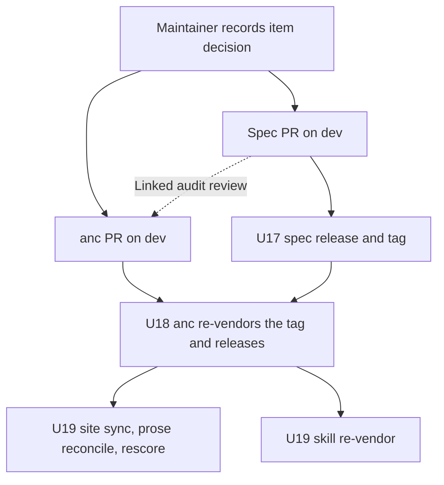

# anc v0.7.0 Spec Alignment - Plan

**Target repos:** `brettdavies/agentnative` (the spec, this repo) and `brettdavies/agentnative-cli` (anc). Unprefixed
paths are in this repo; `cli:` paths are in agentnative-cli.

## Goal Capsule

- **Objective:** for each of the nine items below, the standard's text and anc's grade give the same verdict for the
  same tool, and the standard no longer contradicts itself, so a tool author who reads the spec, an `anc audit`
  scorecard, and anc.dev reaches one answer.
- **Means:** the maintainer records each item's direction in Key Decisions; each chosen side lands as one spec PR paired
  with one anc PR (KTD1); a spec tag precedes the anc release that vendors it (KTD2).
- **Authority:** the maintainer's per-item decisions outrank this plan's recommendations. The spec's `CONTRIBUTING.md`
  and `RELEASES.md` govern spec PRs and releases; agentnative-cli's `AGENTS.md` and `RELEASES.md` govern anc work. This
  plan governs scope and sequencing.
- **Execution profile:** one `fix/` branch per repo per decided item, cut from that repo's `dev` in a standalone clone.
  U17 to U19 run per release batch: once the PRs of every item decided so far have merged, and again for items decided
  later.
- **Stop conditions:**
  - An item's decision reads `pending`: skip that item's units.
  - Evidence contradicts an item's recorded decision, such as a tool its Example line names getting a different verdict
    than the item states: stop and report before opening the PR.
  - Any step that merges a PR, tags, or publishes: stop. Those are the maintainer's acts.
- **Who finishes:** the maintainer merges each paired PR into `dev` in both repos, merges the spec release PR (U17), and
  runs anc's release (U18). U19's downstream syncs follow anc's release.

---

## Product Contract

### Summary

Close nine places where spec v0.7.0 and anc v0.7.0 disagree, or where the spec disagrees with itself. Each item below
carries its evidence, the ways to close it, and a recommendation. The maintainer chooses per item, and only the units
for the chosen side run. No spec or anc text changes until a choice is recorded.

### Problem Frame

anc v0.7.0 credits flags, exemptions, and declarations that the spec text does not name, and in two places the spec's
own text points two ways. A tool can pass a MUST in anc that a reader of the spec would fail, or the reverse, and
anc.dev then shows principle pages and scorecards that disagree.

All the anc behavior below shipped in v0.7.0 (2026-10-27) or earlier, most of it in cli#143, #147, #195, #196, and #197.
anc v0.7.0 vendors spec 0.6.0, and anc `dev` vendors 0.7.0 (cli#254). The spec's single-letter reading rule (#59) and
anc's opposite letter rule (cli#197) merged 18 minutes apart on 2026-10-26.

### Requirements

**Agreement per item**

- R1. P2 and P4 text and anc agree on which flags select JSON output and on when the JSON error contract applies (item
  1).
- R2. P5 text and anc agree on which operations need a confirmation flag (item 2).
- R3. P3 text and anc agree on which prefixed command-list line is the bare invocation (item 3).
- R4. The spec's flag-name reading rule, P5's other-name clause, and anc agree on when a single-letter flag meets a
  requirement (item 4).
- R5. P7 and P6 text and anc agree on the names that meet the limit, timeout, and cursor-pagination requirements, and on
  where the P7 timeout requirement applies (item 5).
- R6. `p8-should-bundle-exists` gets one verdict per scorecard, and every audit anc groups under a principle covers a
  requirement of that principle (item 6).
- R7. `p1-should-tty-detection` names one stream across its summary, prose, and examples, and the audit that covers it
  checks that requirement (item 7).
- R8. P1 text and anc agree on which tools `p1-must-no-browser` applies to and which flags meet it (item 8).
- R12. P2 and P4 text and anc agree on the field names a JSON error carries and the stream it goes to (item 9).

**Delivery**

- R9. Every spec PR that changes a requirement names the anc PR that grades it in its Linked audit review section.
- R10. A released anc never grades requirement text that no spec tag carries.
- R11. After anc's release, agentnative-site and agentnative-skill vendor the new spec tag, the site's principle copy is
  reconciled to it, and the site's registry scorecards are regenerated with the released anc.
- R13. anc's tests fail when an audit credits a long flag name that the vendored spec text for the requirement it covers
  never names.

### Key Decisions

- **Spec v0.7.0 shipped before these gaps closed.** (session-settled: user-directed — chosen over holding v0.7.0 until
  they closed: the release carried #58's fixes, which anc already graded.) Governs R10.
- **Each item's direction is the maintainer's choice.** (session-settled: user-directed — chosen over this plan fixing
  one direction: each item trades strictness against credit for tools agents already use.) Governs R1-R8, R12.
- **Recommendations favor what an agent relies on, not the cheaper change.** (session-settled: user-approved — proposed
  with the scope and confirmed.) Governs R1-R8, R12.
- **Item decisions.** Option letters are defined per item in Item Evidence and Options. Governs R1-R8, R12.

| Item                                            | Recommended | Decision |
| ----------------------------------------------- | ----------- | -------- |
| 1. JSON output flags and the JSON error trigger | C           | pending  |
| 2. What counts as destructive                   | C           | pending  |
| 3. Default-command lines with placeholders      | C           | pending  |
| 4. Single-letter flags                          | A           | pending  |
| 5a. Limit names                                 | C           | pending  |
| 5b. Timeout names and scope                     | C           | pending  |
| 5c. Cursor-pagination names                     | C           | pending  |
| 6. `p6-agents-md`                               | B           | pending  |
| 7. TTY-detection stream                         | A + B1      | pending  |
| 8. Headless authentication scope                | C           | pending  |
| 9a. JSON error field names                      | B           | pending  |
| 9b. JSON error stream                           | A           | pending  |

### Scope Boundaries

- No spec or anc text changes for an item whose decision is `pending`.
- Site and skill work is limited to the re-vendor, prose reconciliation, and rescore in U19.
- No requirement `id` is added, renamed, or removed (KTD4).
- Considered and not built: restricting `[p5] not_destructive` to a project's own `.anc.toml`. anc's scorecard schema
  documents the user-level `~/.anc.toml` as a supported scope (`config_hint.files`, scope `user`), and item 2's
  structured waiver field makes every waiver visible whichever file supplied it. A waiver applied from a third party's
  home directory to a registry score would change that call.
- Considered and not built: a spec-wide rule that any documented equivalent meets any named flag. Items 1, 4, and 5
  settle the cases anc grades; a blanket rule would also loosen requirements anc does not grade by name.

---

## Item Evidence and Options

### Item 1. JSON output flags and the JSON error trigger

- **Spec:** `p2-must-output-flag` (MUST) reads "Structured-output CLIs MUST offer at least one machine-readable format
  selectable via `--output`", and `p2-should-json-aliases` lets `--json` and `--jsonl` meet it through the alias path
  (`principles/p2-structured-parseable-output.md`). `p2-must-json-errors` (MUST) and `p4-should-json-error-output`
  (SHOULD) apply "When `--output json` is active". `p2-should-consistent-envelope` names no flag.
- **anc:** `p2-json-output` also credits `--format` by name alone (since v0.1.0) and `--output-format` when its
  definition names `json` (cli#195) (`cli:src/audits/behavioral/output_flags.rs`). The three error audits
  (`p2-json-errors`, `p4-json-error-output`, `p2-consistent-envelope`) run under any JSON mode the top-level help
  declares (cli#196), and read only the top-level help.
- **Example:** rg declares only `--json`, shellcheck declares `--format` with `json` among its values, and yq declares
  `--output-format`. None of them ever has `--output json` active, yet anc grades rg's and shellcheck's JSON errors
  (rg's `p2-must-json-errors` moved from skip to fail). A tool whose `--output json` exists only on subcommands, the gh
  and kubectl shape, gets `skip` on all three error rows.
- **Options:**
  - A. Spec: an output-format option under another name meets `p2-must-output-flag` when its definition names `json`,
    with `--output` canonical; the error and envelope requirements apply whenever a JSON output mode is active.
  - B. anc: credit only `--output` and the aliases, and run the error audits only under `--output json` or an alias.
    shellcheck and yq drop to `opt_out` on the MUST.
  - C. A, plus anc holds `--format` to the same names-json test as `--output-format` and looks for a JSON mode in
    subcommand help when the top-level help declares none, as `p2-json-output` already does.
- **Recommendation: C.** An agent selects JSON with whatever flag the help documents and then parses errors under that
  same mode, so a requirement keyed to one spelling misses tools agents already drive this way. C also closes two loose
  ends in anc: a Go-template `--format` counted by name, and subcommand-only JSON tools skipped.

### Item 2. What counts as destructive

- **Spec:** `p5-must-force-yes` (MUST, if the CLI has destructive operations) reads "Destructive operations (delete,
  overwrite, bulk modify) MUST require an explicit confirmation flag." That parenthetical is the only definition of
  destructive, and P5 has no declaration or exclusion. #58 changed only the confirmation-flag wording.
- **anc:** `.anc.toml [p5] not_destructive` (cli#147) removes listed subcommands from `p5-force-yes`'s destructive set,
  which anc detects by name (`delete`, `remove`, `rm`, `destroy`, `purge`, `wipe`, `reset`, `drop`, `clean`, `force-`).
  An entry that is not lowercase or names no listed subcommand is accepted silently, and so is `delete`. The waiver
  appears only in the row's evidence prose.
- **Example:** in cli#147's table, auditing biome with `not_destructive = ["clean"]` turns its `p5-force-yes` row to
  `skip`. The same file can list `delete`, while by the spec a `delete` still needs a confirmation flag.
- **Options:**
  - A. Spec: define a destructive operation by its effect: it deletes or overwrites data the tool cannot regenerate, or
    modifies many records at once. Clearing data the tool rebuilds on demand, such as a cache, is not destructive.
  - B. anc: drop `not_destructive`, so every name-detected subcommand needs a confirmation flag. biome's `clean` fails.
  - C. A, plus anc warns on an entry that is not lowercase or names no listed subcommand, and records each waiver in a
    structured scorecard field.
- **Recommendation: C.** The confirmation gate exists so one call cannot lose data an agent needs, and a cache clear
  loses none. anc's name list cannot tell the two apart, so the author's declaration carries the definition, and the
  structured field shows every reader what was waived.

### Item 3. Default-command lines with placeholders

- **Spec:** `p3-should-unprefixed-command-list` (SHOULD, if the CLI uses subcommands) reads "The bare invocation line,
  which documents what the tool does with no arguments, is the one entry that legitimately carries the binary name
  alone." P3 has no placeholder exemption.
- **anc:** `p3-unprefixed-command-list` also exempts a prefixed line whose remaining words all start with `[` or `<`
  (cli#143). An uppercase metavariable still warns.
- **Example:** `opencode [project]   start opencode tui` and `gemini [query..]` pass anc and fail the spec's wording,
  while `tool FILE   Open a file` warns in anc although it has the same default-command shape.
- **Options:**
  - A. Spec: the bare-invocation entry may add argument placeholders (`[project]`, `<path>`, `FILE`) and still carries
    the binary name legitimately.
  - B. anc: drop the placeholder exemption. opencode and gemini warn.
  - C. A, plus anc treats an all-caps metavariable as a placeholder.
- **Recommendation: C.** The rule lets an agent lift command tokens from the left column, and a default-invocation line
  names no command token whether or not it adds placeholders. C makes anc's placeholder test match the forms help text
  uses.

### Item 4. Single-letter flags

- **Spec:** the reading rule in `README.md` § Reading the spec (#59) says "A single letter is a different name in either
  case and meets only a requirement that names that letter". anc vendors `principles/` and not the README, so the rule
  never reaches anc's copy. P5's `p5-must-force-yes` says a flag under another name meets it "when the command's
  `--help` documents it as the flag that confirms the operation without a prompt", which reads on
  `-y  Skip confirmation prompts`. The spec names `-v` for both verbose (`p7-should-verbose`) and version
  (`p3-should-version-short`).
- **anc:** since cli#197, a letter counts when its own definition means what the audit asks for, through an accepted
  long name on the same line or a description word (`cli:src/audits/behavioral/flag_meaning.rs`). It credits letters
  this way for `p7-must-quiet` (`-q`), `p7-should-limit` (`-n`), `p7-should-verbose` (`-v`), `p5-must-force-yes` (`-y`,
  `-f`), and `p1-must-no-interactive` (`-y`, `-p`); on anc `dev`, cli#259 adds `p3-should-version-short`. A letter with
  no description does not count, even where the requirement names it. anc's own note on its vendored copy,
  `cli:src/principles/spec/README.md` on `dev`, says the audits read help "by the same rule" as the spec.
- **Example:** unzip's `-q  quiet mode`, with no `--quiet`, passes `p7-must-quiet` in anc and fails it under the spec
  rule. A lone `-v` with no description meets the spec's name test for both verbose and version.
- **Options:**
  - A. Spec: a single letter meets a requirement when its help definition states that requirement's meaning, through a
    long name the requirement accepts on the same line or a description that names the meaning. The same test applies to
    a letter the requirement names, because one letter can carry two meanings. The rule moves to a file anc vendors
    (KTD6).
  - B. anc: credit a letter only for a requirement that names it, dropping `-q`, `-n`, `-y`, `-f`, and `-p`, and the
    spec rewords P5's other-name clause to exclude letters. unzip-style tools fail `p7-must-quiet`, and a lone `-v`
    passes verbose.
- **Recommendation: A.** An agent learns what a letter does from its definition, and P5 already accepts documented
  equivalents. The definition test tells verbose `-v` from version `-v`, which the name test cannot. A matches anc's
  shipped behavior. It reverses part of #59, which the maintainer merged on 2026-10-26.

### Item 5. Limit, timeout, and cursor-pagination names

- **Spec:** `p7-should-limit` names `--limit` and `--max-results`. `p7-should-timeout` (SHOULD, universal) names
  `--timeout`, as does `p6-must-timeout-network` (MUST, if the CLI makes network calls). `p7-may-cursor-pagination`
  names `--after` and `--before`. No spec version has named the extra flags below.
- **anc (since v0.5.0, cli#55 and #56):** `p7-limit` accepts `--max` and `--top` by name and `-n` by meaning.
  `p7-timeout-behavioral` accepts `--deadline` and `--max-time`, and runs only when a subcommand name reads as
  long-running (`serve`, `daemon`, `watch`, `tail`, `monitor`, `follow`, `run`, `start`, `stream`).
  `p7-cursor-pagination` accepts `--cursor`, `--page`, and `--offset`.
- **Example:** helm's `list --max` passes the limit audit and its `--offset` passes cursor pagination. A `watch`
  subcommand with only `--max-time` passes the timeout audit. A tool with no long-running subcommand is never graded on
  `p7-should-timeout`, though the spec applies it to every CLI.
- **Options and recommendations:**
  - 5a, limit. A: the spec accepts an option whose definition bounds the number of items returned (`--max`, `--top`,
    `-n`), with `--limit` canonical. B: anc drops `--max`, `--top`, and `-n`. C: A, plus anc applies its definition test
    to `--max` and `--top` as it does to `-n`. **Recommendation: C.**
  - 5b, timeout. A: `p7-should-timeout` and `p6-must-timeout-network` accept documented equivalents (`--deadline`,
    `--max-time`), and `p7-should-timeout` applies to commands that can run unbounded (servers, watchers, streams),
    leaving network calls to `p6-must-timeout-network`. B: anc drops the two names and runs `p7-timeout-behavioral` on
    every tool. C: A, plus anc's long-running gate becomes the documented applicability. **Recommendation: C.**
  - 5c, cursor pagination. A: the spec names `--cursor` beside `--after` and `--before`. B: anc stops crediting `--page`
    and `--offset`. C: both. **Recommendation: C.**
- **Reason:** agents bound result size and run time with whatever the help documents, so the documented names belong in
  the text. Positional paging drifts when results change between calls, which is the failure cursor pagination exists to
  prevent, so `--page` and `--offset` do not meet it.

### Item 6. `p6-agents-md`

- **Spec:** `p6-agents-md` appears nowhere in spec 0.7.0, because #58 removed it from P6's audit list.
  `principles/AGENTS.md` says "The verifier emits one result entry per requirement row". `p8-should-bundle-exists`
  (SHOULD) asks for a top-level `AGENTS.md` or `SKILL.md` with frontmatter.
- **anc:** `p6-agents-md` (project layer, grouped under P6) covers `p8-should-bundle-exists` and checks only that
  `AGENTS.md` exists. `p8-bundle-exists` covers the same requirement, accepting `AGENTS.md` or `SKILL.md` with
  frontmatter. A source audit therefore emits two rows for the requirement, and they can disagree.
  `anc emit coverage-matrix` titles the P8 section "P8: Unknown".
- **Example:** a repo with only `SKILL.md` gets `warn` from `p6-agents-md` under `--principle 6` and `pass` from
  `p8-bundle-exists` under `--principle 8`, both as rows for `p8-should-bundle-exists`.
- **Options:**
  - A. Spec: list `p6-agents-md` among P8's audit IDs, keeping two verifiers.
  - B. anc: retire `p6-agents-md` so `p8-bundle-exists` is the one verifier, and name the P8 section.
  - C. anc regroups `p6-agents-md` under P8, and the spec lists it there.
- **Recommendation: B.** `p8-bundle-exists` checks everything `p6-agents-md` does and more, so the second row only adds
  a contradicting verdict. Spec 0.7.0 already matches B, which leaves the work to anc alone.

### Item 7. TTY-detection stream

- **Spec:** `p1-should-tty-detection` (SHOULD) names stderr in its summary ("suppress prompts when stderr is not a
  terminal"), stdin in its prose ("TTY detection on stdin (and stderr, where prompts target it)"), and stdout in its
  Python example (`sys.stdout.isatty()`). The prose says these entry points "appear in the Evidence section", which
  lists none of them. `p1-must-no-interactive` applies "When stdin is not a terminal".
- **anc:** `p1-tty-detection-source` (Rust source, labeled "TTY detection for color output") covers
  `p1-should-tty-detection`. It triggers on color code and passes on any `is_terminal` or `atty` substring, whatever the
  stream, which is the TTY half of `p6-must-no-color` ("color codes suppressed when stdout/stderr is not a terminal"),
  not prompt handling.
- **Options:**
  - A, spec, needed under every decision: the requirement names stdin as the detection stream, plus stderr where a
    prompt renders there. The summary, prose, and examples agree (`sys.stdin.isatty()`), and the Evidence section lists
    the entry points the prose cites.
  - B1, anc: re-point `p1-tty-detection-source` to cover `p6-must-no-color`, the requirement it checks.
  - B2, anc: rework the audit to find prompt calls guarded by a stdin TTY check.
- **Recommendation: A with B1.** Prompts read stdin, and the MUST beside this SHOULD already keys on stdin. The color
  audit verifies a real requirement, just not this one. Source-layer rows do not enter the score, so B1 changes coverage
  reporting only.

### Item 8. Headless authentication scope

- **Spec:** `p1-must-no-browser` (MUST, if the CLI authenticates against a remote service) asks for "A headless
  authentication path if the CLI authenticates", with `--no-browser` canonical and `--device-code`, `--remote`, and
  `--headless` acceptable. It never says whether a tool whose only credential is an API key or token meets it, and a
  [wontfix] pressure-test note calls service-account auth "orthogonal".
- **anc:** `p1-headless-auth` (Rust source only, outside the score) warns when a function name holds an auth keyword and
  no file with an `#[arg]` attribute contains "no-browser" or "headless". It does not credit `--device-code` or
  `--remote`.
- **Example:** an API-key tool with `fn authorization_header()` gets `warn`, and the same tool with `fn api_key()` gets
  `skip`. A browser-only OAuth tool with an unrelated `--headless` rendering flag gets `pass`.
- **Options:**
  - A. Spec: the requirement applies to tools that authenticate through a browser-based flow. A tool whose only
    credentials are static (an API key or token from the environment or a file) has no browser to avoid, and
    `p1-must-secret-non-leaky-path` governs how it reads them.
  - A2. Spec: a static-credential path counts as headless, so the requirement still applies to every authenticating tool
    and API-key tools pass.
  - B. anc only: credit `--device-code` and `--remote`, and require the flag text on an argument definition rather than
    anywhere in the file.
  - C. A plus B, with anc triggering on code that opens a browser rather than on auth-like function names.
- **Recommendation: C.** The MUST exists because an agent cannot click through a browser, and an API-key tool never asks
  it to, so not applicable is the true verdict for that tool. anc should look for the browser launch the requirement is
  about.

### Item 9. JSON error field names and stream

- **Spec:** `p2-must-json-errors` (MUST) reads "When `--output json` is active, errors MUST be emitted as JSON to stderr
  with at least `error`, `kind`, and `message` fields." `p4-should-json-error-output` (SHOULD) reads "JSON-formatted
  errors go to stderr when JSON output is selected."
- **anc:** `p2-json-errors` checks three roles, not three names: "Either the traditional `{error, kind, message}` shape
  OR the canonical `{status, reason, exit_code, message}` shape ... satisfies all three roles"
  (`cli:src/audits/behavioral/json_errors.rs`). `p4-json-error-output` passes when stderr or stdout parses as JSON
  (`cli:src/audits/behavioral/json_error_output.rs`).
- **Example:** a `{"status":"error","reason":"not-found","exit_code":4,"message":"..."}` envelope on stdout, the shape
  `anc skill install` emits, passes both audits. By the spec it carries none of the three named fields and uses the
  wrong stream.
- **Options and recommendations:**
  - 9a, field names. A: the spec defines the fields by role (an error class, a machine-matchable code, a human message),
    with `error`, `kind`, and `message` as one conforming spelling. B: anc requires the field names the spec names.
    **Recommendation: B.** An agent branches on fixed keys, and a per-tool spelling makes it parse each tool
    differently. The maintainer settled the same question for xurl-rs on 2026-09-16 by adding the spec's `error` and
    `kind` beside its own `reason`, which treats the spec's names as the contract.
  - 9b, stream. A: the spec allows the JSON error on stderr, or on stdout inside the envelope the success output uses.
    B: anc requires stderr. **Recommendation: A.** Agents capture both streams, anc already grades either, and A keeps
    the stdout envelope that `docs/plans/2026-04-29-001-feat-p2-p4-output-envelope-shoulds-plan.md` proposes within the
    rule.

---

## Planning Contract

### Key Technical Decisions

- KTD1. **One spec PR and one anc PR per decided item.** Each spec PR names its anc PR in Linked audit review (R9), so
  every PR carries one decision. Chosen over one spec PR for all items, because a combined PR would let one contested
  item hold the rest.
- KTD2. **Spec tag before anc release.** Within a pair, the spec PR merges to spec `dev` first and the anc PR follows,
  so anc `dev` never holds an item that no spec batch carries; an anc-only option has no spec PR to wait for. U17 tags
  the spec, then U18 re-vendors that tag and releases anc. This order is R10's mechanism: anc v0.7.0 shipped first and
  graded text no tag carried.
- KTD3. **The release version follows the highest tier changed.** Per `CONTRIBUTING.md`, any decided change to a MUST
  (items 1, 2, and 8 in their spec options, and item 4 B through P5's clause) makes the release 0.8.0. A release with
  only SHOULD, MAY, or prose changes is 0.7.1.
- KTD4. **Requirements are reworded, never re-identified.** Consumers pin frontmatter ids, so text, accepted names, and
  applicability change while ids stay. Each touched principle bumps `last-revised` per `principles/AGENTS.md`.
- KTD5. **anc's pending release is not held for this plan.** anc `dev` already vendors spec 0.7.0 (cli#254) and can
  release before any item here is decided, so the site's scorecards reach 0.7.0 sooner. This plan's anc changes ride a
  later release.
- KTD6. **The flag-name reading rule moves under `principles/`.** anc vendors `principles/*.md` and
  `principles/scoring.md`, so only a rule in one of those files reaches anc's vendored copy. U7 picks the file and
  leaves the README pointing to it.
- KTD7. **A test keeps anc's accepted names inside the spec text.** Linked audit review is a human step, and
  cli#143, #147, #195, #196, and #197 merged without a paired spec PR, which is how these items opened. U20 makes anc's
  suite fail on the next unnamed flag. Chosen over relying on the PR template alone.

### High-Level Technical Design

Each decided item flows through the same chain; the per-item units differ only in which repo changes.



Which units run for each decision:

| Item       | A             | B                   | C           |
| ---------- | ------------- | ------------------- | ----------- |
| 1          | U1            | U2                  | U1, U2      |
| 2          | U3            | U4                  | U3, U4      |
| 3          | U5            | U6                  | U5, U6      |
| 4          | U7            | U7, U8              | not offered |
| 5a, 5b, 5c | U9            | U10                 | U9, U10     |
| 6          | U11           | U12                 | U11, U12    |
| 7          | U13           | U13, U14 (B1 or B2) | not offered |
| 8          | U15 (A or A2) | U16                 | U15, U16    |
| 9a, 9b     | U21           | U22                 | U21, U22    |

### Risks & Dependencies

- `docs/plans/2026-04-29-001-feat-p2-p4-output-envelope-shoulds-plan.md` (proposed) rewrites `p2-must-json-errors` (its
  R1 moves JSON errors to stdout), `p2-should-consistent-envelope`, and `p4-should-json-error-output`: the requirements
  U1 re-triggers and item 9 reads. Whichever lands second rebases its wording on the first.
- U4 under C adds a scorecard field, which is a public contract. The site's `content/scorecard-schema.md` lists each
  field with the schema version that added it, and the skill names the schema version it targets; U19 updates both.
- B options and anc tightenings move real tools' rows: shellcheck and yq (item 1 B), biome (item 2 B), unzip (item 4 B),
  helm (items 5a B and 5c). Each anc PR body lists the rows it moves; U19's rescore publishes them.
- Item 4 A reverses part of #59, three days after it merged. The spec PR names #59 and states the conflict with P5's
  clause and the double `-v`.
- anc's pending release (KTD5) and U18 both re-vendor the spec. If anc has not released by U18, U18's release carries
  both.

---

## Implementation Units

| U-ID | Title                                     | Repo        | Runs when          | Depends on             |
| ---- | ----------------------------------------- | ----------- | ------------------ | ---------------------- |
| U1   | JSON output flags in P2 and P4            | spec        | item 1 A or C      | decision               |
| U2   | JSON output flags in anc                  | cli         | item 1 B or C      | decision               |
| U3   | Destructive defined by effect in P5       | spec        | item 2 A or C      | decision               |
| U4   | `not_destructive` in anc                  | cli         | item 2 B or C      | decision               |
| U5   | Placeholder default lines in P3           | spec        | item 3 A or C      | decision               |
| U6   | Placeholder default lines in anc          | cli         | item 3 B or C      | decision               |
| U7   | Single-letter reading rule                | spec        | item 4 any         | decision               |
| U8   | Single-letter crediting in anc            | cli         | item 4 any         | decision               |
| U9   | Limit, timeout, cursor names in P6 and P7 | spec        | 5a/5b/5c A or C    | decision               |
| U10  | Limit, timeout, cursor names in anc       | cli         | 5a/5b/5c B or C    | decision               |
| U11  | `p6-agents-md` in P8's audit list         | spec        | item 6 A or C      | decision               |
| U12  | `p6-agents-md` in anc                     | cli         | item 6 B or C      | decision               |
| U13  | TTY-detection stream in P1                | spec        | item 7 any         | decision               |
| U14  | TTY-detection coverage in anc             | cli         | item 7 B1 or B2    | decision               |
| U15  | Headless-auth scope in P1                 | spec        | item 8 A, A2, or C | decision               |
| U16  | Headless-auth audit in anc                | cli         | item 8 B or C      | decision               |
| U17  | Spec release                              | spec        | per batch          | the batch's PRs merged |
| U18  | anc re-vendor and release                 | cli         | per batch          | U17                    |
| U19  | Site and skill sync                       | site, skill | per batch          | U18                    |
| U20  | Spec-name drift guard in anc              | cli         | once               | U18                    |
| U21  | JSON error fields and stream in P2 and P4 | spec        | 9a A, or 9b A      | decision               |
| U22  | JSON error fields and stream in anc       | cli         | 9a B, or 9b B      | decision               |

Every spec unit's PR fills the spec PR template, including Linked audit review (R9), and its `## Changelog` entry is the
user-facing line. Every anc unit's PR body lists each real-tool row it moves and names the existing tests it changes
because they pinned the superseded behavior. A moved row that the item's decision does not explain is a defect in that
PR. Each anc PR's `## Changelog` entry names the requirement, the rule as decided, and one tool whose row moves, because
tool authors read anc's changelog, not its PR bodies. A row that moves under this plan says in its evidence what it
found, what the requirement accepts, and the principle that says so.

### U1. JSON output flags in P2 and P4

- **Goal:** P2 and P4 name every flag that selects JSON and apply the error contract under any of them.
- **Requirements:** R1, R9; KTD1, KTD4.
- **Dependencies:** item 1 decision; for C, U2's PR exists so its URL goes in Linked audit review.
- **Files:** `principles/p2-structured-parseable-output.md`, `principles/p4-fail-fast-actionable-errors.md`.
- **Approach:**
  1. `p2-must-output-flag` summary, prose, and Evidence: an output-format option under another name meets the MUST when
     its definition names `json`; `--output` stays canonical.
  2. State once, in P2, what "a JSON output mode is active" means (`--output json`, a `--json` or `--jsonl` alias, or
     such an option), and make `p2-must-json-errors` and `p4-should-json-error-output` apply under it; P4 cites P2
     rather than restating the list.
  3. Bump `last-revised` in both files.
- **Test expectation:** none -- prose and frontmatter. `validate-principles` and `check-last-revised` in the pre-push
  hook gate the change.
- **Verification:** reading P2 alone, a reviewer can say whether rg, shellcheck, and yq meet `p2-must-output-flag`, and
  whether each one's JSON errors are graded.

### U2. JSON output flags in anc

- **Goal:** anc credits the flags and modes item 1's decision names, and no others.
- **Requirements:** R1; KTD1.
- **Dependencies:** item 1 decision.
- **Files:** `cli:src/audits/behavioral/output_flags.rs`, `cli:src/audits/behavioral/json_output.rs`,
  `cli:src/audits/behavioral/error_probe.rs`, `cli:src/audits/behavioral/json_errors.rs`,
  `cli:src/audits/behavioral/json_error_output.rs`, `cli:src/audits/behavioral/consistent_envelope.rs`, `cli:README.md`.
- **Approach:**
  - Under C: `--format` joins `--output-format` in the names-json list; `json_mode` reads top-level subcommands' help
    when the top-level help declares no JSON mode, using the search `p2-json-output` already does and the subcommand
    help it already fetched, and probes that subcommand.
  - Under B: the accepted output flag is `--output` plus the boolean aliases, and `json_mode` returns only those.
  - The README `json_probe` paragraph names the accepted flags as the decision states them.
- **Test scenarios:**
  - C: `--format <F>  Output format (text, json)` yields JSON mode `--format json`.
  - C: `--format <TEMPLATE>  Go template for output` is not an output flag, and `p2-json-output` reads `opt_out`.
  - C: a top-level help with no JSON mode and a `list` subcommand declaring `--output <FMT>  json|text` puts all three
    error audits on `list` with `--output json`, not `skip`.
  - B: shellcheck's help gives `p2-json-output` `opt_out` and the error audits `skip` with the no-JSON-mode reason.
  - Either: rg's boolean `--json` still selects JSON through the alias path.
- **Verification:** the CLI pre-push gate passes, and the PR body's table lists the moved rows for rg, shellcheck, yq,
  and a subcommand-only tool.

### U3. Destructive defined by effect in P5

- **Goal:** P5 defines a destructive operation by what it does, so a cache clear is outside `p5-must-force-yes`.
- **Requirements:** R2, R9; KTD3, KTD4.
- **Dependencies:** item 2 decision.
- **Files:** `principles/p5-safe-retries-mutation-boundaries.md`.
- **Approach:** the Definition paragraph and the MUST's summary and prose define destructive by effect, as item 2 A
  states, and the Evidence line follows; the anti-pattern about an immediate `delete` stays. Bump `last-revised`.
- **Test expectation:** none -- prose and frontmatter; the pre-push validators gate it.
- **Verification:** from P5 alone, a reviewer can say that biome's cache `clean` is not destructive and that a `delete`
  of user records is.

### U4. `not_destructive` in anc

- **Goal:** every `not_destructive` waiver is valid and visible, or the setting is gone, per item 2's decision.
- **Requirements:** R2; KTD1.
- **Dependencies:** item 2 decision.
- **Files:** `cli:src/anc_toml/settings.rs`, `cli:src/anc_toml/mod.rs`, `cli:src/audits/behavioral/force_yes.rs`,
  `cli:src/scorecard/mod.rs`, `cli:README.md`.
- **Approach:**
  - Under C: an entry that is not lowercase, or names no subcommand the help lists, produces a warning in the row's
    evidence and is not applied. Each applied waiver appears in a structured row field naming the subcommand and the
    file that supplied it, beside the existing evidence text; the scorecard schema version moves with the new field.
  - Under B: the setting is removed and its README section goes. An `.anc.toml` that still sets it is read with the key
    ignored, and anc says so once on stderr and in the row's evidence: `[p5] not_destructive` is no longer read, and P5
    defines what counts as destructive.
- **Test scenarios:**
  - C: `not_destructive = ["Clean"]` with a `clean` subcommand leaves `clean` in the destructive set and names the
    casing in evidence.
  - C: `not_destructive = ["purge"]` with no `purge` subcommand warns that the entry matches nothing.
  - C: `not_destructive = ["clean"]` on biome's help gives `skip`, and the row carries the structured waiver naming
    `clean` and `.anc.toml`.
  - C: the scorecard JSON Schema `anc emit schema` prints declares the new field, and the schema version moves.
  - B: biome's help with the same file gives `p5-force-yes` `fail` for `clean`.
  - B: a file that still sets `not_destructive` produces the removal notice on stderr and in the row's evidence.
- **Verification:** the CLI pre-push gate passes; under C, the new field appears in `anc audit --output json` for the
  biome case.

### U5. Placeholder default lines in P3

- **Goal:** P3's bare-invocation exemption covers a default-command line with argument placeholders.
- **Requirements:** R3, R9; KTD4.
- **Dependencies:** item 3 decision.
- **Files:** `principles/p3-progressive-help-discovery.md`.
- **Approach:** the bare-invocation sentence admits argument placeholders written as `[x]`, `<x>`, or an all-caps
  metavariable. Bump `last-revised`.
- **Test expectation:** none -- prose and frontmatter; the pre-push validators gate it.
- **Verification:** from P3 alone, `opencode [project]` is the exempt entry and `opencode run [message..]` is not.

### U6. Placeholder default lines in anc

- **Goal:** anc's placeholder test matches item 3's decision.
- **Requirements:** R3; KTD1.
- **Dependencies:** item 3 decision.
- **Files:** `cli:src/audits/behavioral/unprefixed_command_list.rs`.
- **Approach:**
  - Under C: `is_bare_invocation` also counts an all-caps metavariable token as a placeholder.
  - Under B: `is_bare_invocation` is true only for an empty remainder.
- **Test scenarios:**
  - C: `tool FILE   Open a file` in a prefixed block is not an offender.
  - C: `tool run FILE   Run a file` is an offender, because `run` names a command.
  - B: opencode 1.18's help warns on `opencode [project]`.
  - Either: herdr's bare `herdr` line is not an offender.
- **Verification:** the CLI pre-push gate passes.

### U7. Single-letter reading rule

- **Goal:** one reading rule for flag names lives where anc vendors it and agrees with P5.
- **Requirements:** R4, R9; KTD3, KTD6.
- **Dependencies:** item 4 decision.
- **Files:** `README.md`, the chosen file under `principles/`, `principles/p5-safe-retries-mutation-boundaries.md` (B
  only).
- **Approach:**
  1. Move the § Reading the spec rule into a file under `principles/` that anc vendors; the README keeps a one-line
     pointer.
  2. Under A: the single-letter sentence becomes the definition test item 4 A states, and names the double `-v` as the
     reason it covers named letters.
  3. Under B: the rule keeps its wording, and P5's other-name clause says a single letter meets `p5-must-force-yes` only
     where the requirement names it. Bump P5's `last-revised`.
- **Test expectation:** none -- prose; the pre-push link check and validators gate it.
- **Verification:** one rule governs letters across the spec, and `-y  Skip confirmation prompts` gets the same verdict
  from the rule and from P5.

### U8. Single-letter crediting in anc

- **Goal:** anc's letter crediting and its note on the vendored spec state the decided rule.
- **Requirements:** R4; KTD1.
- **Dependencies:** item 4 decision.
- **Files:** `cli:src/principles/spec/README.md`, `cli:README.md`; under B also
  `cli:src/audits/behavioral/flag_meaning.rs` and the audits that list letters (`quiet.rs`, `limit_flag.rs`,
  `verbose_flag.rs`, `force_yes.rs`, `non_interactive.rs`, `flag_existence.rs`, `version.rs`).
- **Approach:**
  - Under A: no audit change. The sentence in `cli:src/principles/spec/README.md` names the file the rule moved to, and
    the CLI README's letter paragraph cites it.
  - Under B: a letter counts only for an audit whose requirement names it (`-v`, `-vv`, `-V`); the other letters leave
    the accepted lists.
- **Test scenarios:**
  - A: test expectation: none -- documentation only.
  - B: unzip's `-q  quiet mode` gives `p7-quiet` `warn`.
  - B: `-y  Skip confirmation prompts.` on a destructive subcommand gives `p5-force-yes` `fail`.
  - B: a lone `-v` with no description passes `p7-verbose`.
- **Verification:** the CLI pre-push gate passes, and the claim in `cli:src/principles/spec/README.md` matches the
  audits.

### U9. Limit, timeout, cursor names in P6 and P7

- **Goal:** P6 and P7 name the flags and scope items 5a to 5c decide.
- **Requirements:** R5, R9; KTD3, KTD4.
- **Dependencies:** items 5a, 5b, 5c decisions.
- **Files:** `principles/p7-bounded-high-signal-responses.md`,
  `principles/p6-composable-predictable-command-structure.md` (5b only).
- **Approach:**
  - 5a: `p7-should-limit` accepts an option whose definition bounds the item count, with `--limit` canonical.
  - 5b: `p7-should-timeout` and `p6-must-timeout-network` accept `--deadline` and `--max-time` as documented
    equivalents, and `p7-should-timeout`'s applicability becomes commands that can run unbounded.
  - 5c: `p7-may-cursor-pagination` names `--cursor`.
  - Bump `last-revised` in each touched file.
- **Test expectation:** none -- prose and frontmatter; `validate-principles` checks the applicability shape.
- **Verification:** from P7 alone, helm's `list --max` meets the limit SHOULD and its `--offset` does not meet cursor
  pagination.

### U10. Limit, timeout, cursor names in anc

- **Goal:** anc's accepted names and gates match items 5a to 5c.
- **Requirements:** R5; KTD1.
- **Dependencies:** items 5a, 5b, 5c decisions.
- **Files:** `cli:src/audits/behavioral/limit_flag.rs`, `cli:src/audits/behavioral/timeout_behavioral.rs`,
  `cli:src/audits/behavioral/cursor_pagination.rs`.
- **Approach:**
  - 5a C: `--max` and `--top` pass `flag_meaning`'s definition test, as `-n` does. 5a B: they and `-n` leave the list.
  - 5b C: the long-running gate stays and its doc comment cites the requirement's applicability. 5b B: the two names
    leave the list and the gate goes.
  - 5c B or C: `--page` and `--offset` leave the list, and the module doc lists the accepted names.
- **Test scenarios:**
  - 5a C: helm's `-m, --max int  maximum number of releases to fetch` passes; `--max <DEPTH>  Maximum directory depth`
    does not.
  - 5c: helm's `--offset int` on `list` gives `p7-cursor-pagination` no credit.
  - 5c: `--cursor <TOKEN>` on a list subcommand still passes.
  - 5b B: a tool with no long-running subcommand and no `--timeout` gets `warn`.
- **Verification:** the CLI pre-push gate passes.

### U11. `p6-agents-md` in P8's audit list

- **Goal:** P8's audit-ID line names `p6-agents-md`, when item 6 keeps the audit.
- **Requirements:** R6, R9.
- **Dependencies:** item 6 decision.
- **Files:** `principles/p8-discoverable-skill-bundle.md`.
- **Approach:** add the audit ID to P8's measured-by line (under C, after U12 renames or regroups it).
- **Test expectation:** none -- prose.
- **Verification:** every audit ID that covers a P8 requirement appears on P8's line.

### U12. `p6-agents-md` in anc

- **Goal:** `p8-should-bundle-exists` gets one row, or two rows under P8, per item 6's decision, and the coverage matrix
  names P8.
- **Requirements:** R6; KTD1.
- **Dependencies:** item 6 decision.
- **Files:** `cli:src/audits/project/agents_md.rs`, `cli:src/audits/project/mod.rs`, `cli:src/principles/matrix.rs`,
  `cli:docs/coverage-matrix.md`, `cli:coverage/matrix.json`, `cli:README.md`.
- **Approach:**
  - Under B: remove `p6-agents-md` from the registry and the README's P6 row.
  - Under C: group it under P8.
  - Either: `principle_name` names P8, and the coverage artifacts are regenerated with `anc emit coverage-matrix`.
- **Test scenarios:**
  - B: a repo with only `SKILL.md` and frontmatter gets one `p8-should-bundle-exists` row, `pass`.
  - B or C: `anc audit --principle 6` on that repo emits no `p8-should-bundle-exists` row.
  - Either: the coverage matrix's P8 heading carries the principle's name.
  - B: no test, fixture, or committed coverage artifact still names `p6-agents-md`.
- **Verification:** the CLI pre-push gate passes, including the integration test that runs the coverage-matrix check
  against the committed artifacts.

### U13. TTY-detection stream in P1

- **Goal:** `p1-should-tty-detection` names stdin, plus stderr where a prompt renders there, in every place it states
  the rule.
- **Requirements:** R7, R9; KTD4.
- **Dependencies:** item 7 decision.
- **Files:** `principles/p1-non-interactive-by-default.md`.
- **Approach:** the summary, prose, and examples name the same streams (`sys.stdin.isatty()` in the Python example); the
  Evidence section lists the entry points the prose cites. Bump `last-revised`, since the summary changes.
- **Test expectation:** none -- prose and frontmatter; the pre-push validators gate it.
- **Verification:** the summary, prose, and examples of the requirement name the same stream.

### U14. TTY-detection coverage in anc

- **Goal:** the audit that covers `p1-should-tty-detection` checks it, or the color audit covers the color requirement,
  per item 7's decision.
- **Requirements:** R7; KTD1.
- **Dependencies:** item 7 decision; U13's wording for B2.
- **Files:** `cli:src/audits/source/rust/tty_detection.rs`, `cli:docs/coverage-matrix.md`, `cli:coverage/matrix.json`.
- **Approach:**
  - B1: `covers()` names `p6-must-no-color`, and the audit's group moves to P6.
  - B2: the trigger becomes a prompt-library call, and the pass needs a TTY check on stdin.
  - Either: regenerate the coverage artifacts.
- **Test scenarios:**
  - B1: the coverage matrix lists `p1-tty-detection-source` under `p6-must-no-color` and not under
    `p1-should-tty-detection`.
  - B1: `anc audit --principle 6` on a Rust source tree with color code emits the row, and `--principle 1` does not.
  - B2: a `dialoguer::Confirm` call guarded by `stdin().is_terminal()` passes.
  - B2: the same call guarded only by `stdout().is_terminal()` warns.
  - B2: colored output alone does not trigger the audit.
- **Verification:** the CLI pre-push gate passes, including the coverage-matrix check.

### U15. Headless-auth scope in P1

- **Goal:** `p1-must-no-browser` states which authenticating tools it binds, per item 8's decision.
- **Requirements:** R8, R9; KTD3, KTD4.
- **Dependencies:** item 8 decision.
- **Files:** `principles/p1-non-interactive-by-default.md`.
- **Approach:**
  - A or C: applicability becomes tools that authenticate through a browser-based flow, and the prose points static
    credentials to `p1-must-secret-non-leaky-path`.
  - A2: the prose counts a static-credential path as headless.
  - Either: the [wontfix] pressure-test note is replaced by the decided text. Bump `last-revised`.
- **Test expectation:** none -- prose and frontmatter; `validate-principles` checks the applicability shape.
- **Verification:** from P1 alone, a reviewer can say how an API-key-only tool fares on the MUST.

### U16. Headless-auth audit in anc

- **Goal:** `p1-headless-auth` credits the flags P1 accepts and triggers on what the decided applicability names.
- **Requirements:** R8; KTD1.
- **Dependencies:** item 8 decision.
- **Files:** `cli:src/audits/source/rust/headless_auth.rs`.
- **Approach:**
  - B or C: credit `--no-browser`, `--device-code`, `--remote`, and `--headless` only when the name appears in an
    argument definition.
  - C: the trigger is code that opens a browser (a call into a browser-launching crate) instead of an auth-like function
    name; with no such code, the row is `n_a`.
  - Either: the new patterns join the audit's existing pass over each file's parse tree (cli#243) rather than adding a
    second parse.
- **Test scenarios:**
  - B or C: `#[arg(long = "device-code")]` beside an OAuth flow passes.
  - B or C: a `--headless` rendering flag in a file with no auth flag credits nothing.
  - C: an API-key-only crate with `fn authorization_header()` and no browser launch gives `n_a`.
  - C: a crate that calls a browser-launching crate with no headless flag gives `warn`.
- **Verification:** the CLI pre-push gate passes.

### U17. Spec release

- **Goal:** a tagged spec release carries every decided item's text.
- **Requirements:** R10; KTD2, KTD3.
- **Dependencies:** every decided item's spec PR merged to `dev`.
- **Files:** release branch per `RELEASES.md`.
- **Approach:** build the release by `RELEASES.md`'s overlay recipe at the version KTD3 gives, and run the backport
  after the tag.
- **Test expectation:** none -- release mechanics; `RELEASES.md`'s pre-cut checklist and `scripts/release/drift.sh` gate
  it.
- **Verification:** the tag exists, its GitHub Release lists one changelog bullet per item PR, and `spec-release`
  reached agentnative-cli and agentnative-site. The dispatch starts no re-vendor in either repo; U18 and U19 run them.

### U18. anc re-vendor and release

- **Goal:** a released anc vendors the new spec tag and grades its text.
- **Requirements:** R10; KTD2, KTD5.
- **Dependencies:** U17; every decided item's anc PR merged to `dev`.
- **Files:** `cli:src/principles/spec/` (via `cli:scripts/sync-spec.sh`), `cli:docs/coverage-matrix.md`,
  `cli:coverage/matrix.json`.
- **Approach:** run `scripts/sync-spec.sh` for the new tag, regenerate the coverage artifacts, and release by
  agentnative-cli's `RELEASES.md`.
- **Test expectation:** none -- vendoring and release; the CLI pre-push gate and release workflows gate it.
- **Verification:** `anc audit --output json` from the released binary reports the new `spec_version`.

### U19. Site and skill sync

- **Goal:** anc.dev and the skill bundle show the new spec and scores from the released anc.
- **Requirements:** R11.
- **Dependencies:** U18.
- **Files:** agentnative-site `src/data/spec/`, `content/principles/*.md`, `content/principles/VERSION`,
  `public/og-image.png`, `content/scorecard-schema.md` (when U4 adds its field), `src/data/coverage-matrix.json`, and
  its registry scorecards; agentnative-skill's vendored spec and the scorecard schema version it names.
- **Approach:** the site runs `scripts/sync-spec.sh`, reconciles its principle copy to the new text, bumps
  `content/principles/VERSION`, regenerates the OG card, refreshes the coverage matrix with
  `scripts/sync-coverage-matrix.sh`, and rescores the registry with the released anc. The reconciled principle copy
  states the flag-name reading rule, or links to it, wherever a requirement names a flag. The skill re-vendors the tag.
- **Test expectation:** none -- each repo's own gates apply (site: `bun run build`, then `bun test`, and a light and
  dark browser check of each reconciled principle page).
- **Verification:** anc.dev's footer shows the new spec version, and each item's Example tool shows the decided verdict
  on its scorecard.

### U20. Spec-name drift guard in anc

- **Goal:** anc's suite fails when an audit credits a long flag name that the vendored spec text for its covered
  requirement never names.
- **Requirements:** R13; KTD7.
- **Dependencies:** U18, so the guard runs against the re-vendored text.
- **Files:** the audits that list accepted flag names (`cli:src/audits/behavioral/`), `cli:src/principles/matrix.rs`,
  and a test beside them.
- **Approach:**
  1. Each audit that credits flag names declares them through one accessor that the coverage matrix also renders, so the
     guard and the matrix read one list.
  2. The guard reads each requirement's principle file from `cli:src/principles/spec/principles/` and asserts every long
     name the covering audit accepts appears in it. Single letters are exempt under item 4's rule.
  3. Names that belong to a still-pending item sit in an exception list that names the item, and the list shrinks as
     items close.
- **Execution note:** land it in U18's release or after, since it fails against spec text that predates the decided
  items.
- **Test scenarios:**
  - An audit list holding a long name the vendored text lacks fails, naming the audit, the name, the requirement, and
    the two ways to clear it: a spec PR that names the flag, or an exception entry citing a pending item.
  - The same name on the exception list with its item number passes.
  - Every audit passes against the spec tag U17 cut.
- **Verification:** the CLI pre-push gate passes, and the coverage matrix shows each requirement's accepted names.

### U21. JSON error fields and stream in P2 and P4

- **Goal:** P2 and P4 state the field names and stream items 9a and 9b decide.
- **Requirements:** R12, R9; KTD3, KTD4.
- **Dependencies:** items 9a and 9b decisions; U1 when both run, since they edit the same sentences.
- **Files:** `principles/p2-structured-parseable-output.md`, `principles/p4-fail-fast-actionable-errors.md`.
- **Approach:**
  - 9a A: `p2-must-json-errors` defines the three fields by role and names `error`, `kind`, `message` as one spelling.
  - 9b A: `p2-must-json-errors` and `p4-should-json-error-output` allow stderr, or stdout inside the success envelope.
  - Bump `last-revised` in both files.
- **Test expectation:** none -- prose and frontmatter; the pre-push validators gate it.
- **Verification:** from P2 alone, a reviewer can say whether `anc skill install`'s error envelope meets the MUST.

### U22. JSON error fields and stream in anc

- **Goal:** anc's JSON error audits require what items 9a and 9b decide.
- **Requirements:** R12; KTD1.
- **Dependencies:** items 9a and 9b decisions; U2 when both run.
- **Files:** `cli:src/audits/behavioral/json_errors.rs`, `cli:src/audits/behavioral/json_error_output.rs`,
  `cli:src/audits/behavioral/error_probe.rs`, and anc's own error envelope where it lacks the spec's names.
- **Approach:**
  - 9a B: `p2-json-errors` requires `error`, `kind`, and `message` keys; the role check stays as the evidence for which
    key is missing. anc's own JSON errors gain the keys additively, as xurl-rs did.
  - 9b B: `p4-json-error-output` passes only on stderr.
- **Test scenarios:**
  - 9a B: `{"status":"error","reason":"not-found","exit_code":4,"message":"x"}` fails and names the missing keys.
  - 9a B: the same envelope plus `"error": true, "kind": "not-found"` passes.
  - 9a B: anc's own error envelope passes its own audit.
  - 9b B: a JSON error on stdout with plain text on stderr gives `p4-json-error-output` `warn`.
- **Verification:** the CLI pre-push gate passes, and the PR body lists the moved rows.

---

## Verification Contract

| Repo | Gate                                                                                                                                                                                                                    | Units                                             |
| ---- | ----------------------------------------------------------------------------------------------------------------------------------------------------------------------------------------------------------------------- | ------------------------------------------------- |
| spec | `scripts/hooks/pre-push`: md-wrap check, markdownlint, link check, `validate-principles` and its fixture tests, `check-last-revised`, prose-check; then PR CI                                                           | U1, U3, U5, U7, U9, U11, U13, U15, U21            |
| spec | `RELEASES.md` pre-cut checklist and `scripts/release/drift.sh`                                                                                                                                                          | U17                                               |
| cli  | `scripts/hooks/pre-push`: `cargo fmt --check`, `cargo clippy -D warnings` (default and `--features web`), `cargo test` (default and `--features web`), `cargo deny check`, shellcheck, Windows cross-clippy; then PR CI | U2, U4, U6, U8, U10, U12, U14, U16, U18, U20, U22 |
| cli  | `tests/integration.rs` coverage-matrix check against the committed `docs/coverage-matrix.md` and `coverage/matrix.json`                                                                                                 | U12, U14, U18, U20                                |
| cli  | before and after `anc audit --output json` over the tools each item's Example names, attached to the PR body                                                                                                            | U2, U4, U6, U8, U10, U12, U16, U22                |
| site | `bun run build`, then `bun test`, then a browser check in both themes                                                                                                                                                   | U19                                               |

## Definition of Done

- Every item's decision row reads a chosen option or stays `pending` by the maintainer's choice.
- For each decided item, the tools its Example line names get the same verdict from the spec text and from the released
  anc.
- R9: each merged spec PR names its anc PR in Linked audit review.
- R10: the anc release that grades the new text vendors the spec tag that carries it.
- R11: anc.dev's footer and principle pages show the new spec version, and its registry scorecards come from the
  released anc.
- R13: anc's suite fails on an accepted long flag name the vendored spec text never names.
- No code from an abandoned option remains in any PR.

---

## Engineering review

Target: this plan, reviewed with `/plan-eng-review` on 2026-10-29 at `3e0321a`. The maintainer's standing rule for plan
reviews is to answer each question from code, docs, `docs/solutions`, or precedent where they settle it, and to ask only
what a person must decide. Every choice below was settled that way, and none needed the maintainer. The per-item
spec-versus-anc decisions stay reserved to the maintainer in Key Decisions.

### Scope Challenge

- **What already exists:** `HelpOutput`'s lazy accessors (`cli:src/runner/help_probe/mod.rs`, `OnceLock` fields at
  :130-133), `flag_meaning.rs`'s definition test, `p2-json-output`'s subcommand search
  (`cli:src/audits/behavioral/json_output.rs`, `probe_subcommands`), the coverage-matrix check in
  `cli:tests/integration.rs:77`, `scripts/sync-spec.sh` in both downstream repos, and the spec's validators. The units
  reuse each.
- **Minimum change:** every unit maps to one item and one repo, and an item's units run only once it is decided. Nothing
  is deferrable without dropping an item.
- **Complexity:** about 25 files across two repos (8 spec files, about 17 anc files) and two new components (U20's guard
  and its accessor). The gate trips. No smaller arrangement keeps one decision per PR, so the original arrangement
  stands (ledger R1).
- **Search check:** no new architectural pattern or infrastructure; external search not run.
- **TODOS cross-reference:** the spec repo has no `TODOS.md`.
- **Distribution:** no new shipped artifact. The spec and anc ship through their existing release workflows (U17, U18).

Findings:

- [CRITICAL] (confidence: 9/10) Item Evidence and Options: a ninth gap was missing.
  `principles/p2-structured-parseable-output.md` requires "at least `error`, `kind`, and `message` fields" on stderr,
  while `cli:src/audits/behavioral/json_errors.rs` reads "Either the traditional `{error, kind, message}` shape OR the
  canonical `{status, reason, exit_code, message}` shape ... satisfies all three roles", and `json_error_output.rs`
  passes on stdout or stderr. Prior learning applied: xurl-rs-envelope-vs-agentnative-p2-keys (confidence 10/10, from
  2026-09-16).
- [INFORMATIONAL] (confidence: 9/10) Item 2 Example: biome itself declares nothing. The `not_destructive = ["clean"]`
  declaration is the auditor's, in cli#147's table.
- [INFORMATIONAL] (confidence: 8/10) Goal Capsule and U17 to U19: the release units ran "once", but the maintainer may
  decide items in batches.
- [INFORMATIONAL] (confidence: 8/10) Risks: the P2/P4 envelope plan's R1
  (`docs/plans/2026-04-29-001-feat-p2-p4-output-envelope-shoulds-plan.md:64`) also rewrites `p2-must-json-errors`, which
  the risk line omitted.

Scope record: feature answers: none proposed; structure: original arrangement (R1); accepted scope: the plan's units
plus item 9 (R2); pending remedies: none. Result: scope accepted as-is.

Dispositions: item 9 added with its own pending decision rows (R2); the biome wording, the batch release, and the risk
line corrected (factual corrections, no question).

### 1. Architecture review

- [CRITICAL] (confidence: 8/10) Hand-synced list: accepted flag names live in spec prose and in anc constants
  (`output_flags.rs:10-19`, `limit_flag.rs:29`, `timeout_behavioral.rs:27`, `cursor_pagination.rs:22`), and nothing
  fails when they drift. cli#143, #147, #195, #196, and #197 each widened anc without a spec PR, and Linked audit review
  did not catch them.
- [CRITICAL] (confidence: 8/10) KTD2 said paired PRs merge "in either order". An anc PR merged to anc `dev` ahead of its
  spec PR would ride the next anc release while no spec tag carries its text, which is the R10 failure this plan exists
  to stop.
- [INFORMATIONAL] (confidence: 8/10) U4 under C adds a scorecard field. The site's `content/scorecard-schema.md`
  documents fields by the schema version that added them, and the skill names its target schema version; U19 did not
  list either.
- [INFORMATIONAL] (confidence: 7/10) U17's verification implied the `spec-release` dispatch re-vendors downstream. It
  starts no handler; U18 and U19 do the re-vendors.

Design-twice: the plan adds one component with a public surface, U20's accepted-names accessor. The other shape keeps
each audit's constants private and gives the guard its own list of audit and constant pairs. That list is itself
hand-synced (red flag 8), so the accessor wins: the guard and the coverage matrix read one list per audit. Red flags 1
to 7 do not apply.

Dispositions: U20 and KTD7 added (R3); KTD2 now merges the spec PR first (R5); U19 covers the schema docs; U17's
verification states the dispatch's limit.

### 2. Code quality review

- [INFORMATIONAL] (confidence: 7/10) Item 4 and U8 called `cli:src/principles/spec/README.md` "the vendored README". The
  spec's README is not vendored; that file is anc's own note on its vendored copy.
- [INFORMATIONAL] (confidence: 7/10) U16 under C would add browser-launch patterns. cli#243 moved this audit to one
  parse pass per file, and
  `docs/solutions/performance-issues/ast-grep-source-audits-parse-each-file-once-not-once-per-pattern.md` records why a
  second parse is the regression to avoid.
- [INFORMATIONAL] (confidence: 6/10) U2 under C searched subcommand help for a JSON mode. `p2-json-output` already
  fetches that help, and a second fetch doubles the probes for every subcommand-only tool.

Dispositions: wording corrected; U16 states the single pass; U2 reuses the fetched help.

### 3. Test review

Framework: `cargo test` (anc, with fixture tests under `-- --ignored`) and the spec's validator suite.

```text
CODE PATHS (anc, per unit)
[+] U2 output_flags / json_mode
  |-- [GAP -> planned] --format without json in its definition -> opt_out
  |-- [GAP -> planned] JSON mode found only in subcommand help
  `-- [TESTED ***] boolean --json alias (json_output.rs:397)
[+] U4 force_yes / anc_toml
  |-- [GAP -> planned] non-lowercase entry, entry naming no subcommand
  |-- [GAP -> planned] structured waiver field, schema version move
  `-- [TESTED ***] declared clean -> skip (force_yes.rs:582)
[+] U6 unprefixed_command_list
  |-- [GAP -> planned] all-caps metavariable
  `-- [TESTED ***] [project] placeholder (unprefixed_command_list.rs:285)
[+] U8 flag_meaning (B only)
  `-- [TESTED ***] letter tables (quiet.rs:168, verbose_flag.rs:110-151); B rewrites these
[+] U10 limit / timeout / cursor
  |-- [GAP -> planned] --max with a non-count definition
  `-- [TESTED **] helm --max and --offset (limit_flag.rs:420, cursor_pagination.rs:240); 5c rewrites the latter
[+] U12 agents_md
  `-- [GAP -> planned] no stale p6-agents-md reference anywhere
[+] U14 tty_detection
  `-- [GAP -> planned] --principle filter follows the regroup
[+] U16 headless_auth
  `-- [GAP -> planned] --device-code credit, API-key-only n_a, unrelated --headless
[+] U20 drift guard
  `-- [GAP -> planned] unnamed long name fails; exception list passes
[+] U22 json_errors (9a B)
  `-- [GAP -> planned] role-only envelope fails, spec keys pass, anc's own envelope passes

USER FLOW: tool author reads spec, runs anc, reads anc.dev
  `-- [->E2E] U19 rescore: each item's Example tool shows the decided verdict

COVERAGE: every changed branch has a planned scenario | GAPS: 0 unplanned
```

Regression rule: U2, U4, U6, U8, U10, U12, U16, and U22 change graded behavior, and existing tests pin the current
behavior. The regression contract was already the plan's own rule: each anc PR lists every moved row and names the tests
it changes, and a row its decision does not explain is a defect. The review added the before-and-after `anc audit` run
to the Verification Contract so the contract has a check.

Dispositions: U4 schema scenario, U12 stale-reference scenario, and U14 principle-filter scenario added.

### 4. Performance review

- U2 under C adds subcommand help reads only when the top-level help declares no JSON mode, bounded by the top-level
  subcommand count, and now reuses the help `p2-json-output` fetched. Scale: one probe per top-level subcommand at most;
  [estimated].
- U16's patterns join the existing single parse pass.
- U20 reads eight vendored principle files once per test run.

No issues beyond the U2 reuse already recorded.

### Outside voice

Disabled: `codex_reviews` is set to disabled, so no outside reviewer ran and no native replacement was dispatched.

### NOT in scope

- Restricting `not_destructive` to the project's own `.anc.toml`: Scope Boundaries records why.
- A spec-wide documented-equivalent rule: Scope Boundaries records why.
- Fixing the spec's pre-push stage 7 on release trees: it belongs to the v0.7.0 release plan's open follow-up, not to
  this alignment.

### Failure modes

| Path                           | Realistic failure                                           | Covered by                            | User sees                              |
| ------------------------------ | ----------------------------------------------------------- | ------------------------------------- | -------------------------------------- |
| U2 subcommand JSON-mode search | a subcommand's `--help` hangs                               | anc's probe containment (cli#259)     | a skipped row with a reason            |
| U4 structured waiver field     | a consumer pinned to the old schema                         | schema version move; site docs in U19 | the new field, documented              |
| U16 browser-launch trigger     | a tool launches a browser through a crate the patterns miss | n_a evidence names the absent launch  | n_a with its reason, outside the score |
| U18 release batch              | an anc PR for an undecided spec batch                       | KTD2 merge order                      | nothing, if the order holds            |
| U20 guard                      | spec text names a flag in a form the guard does not match   | its test scenarios                    | a failing test naming the flag         |

Critical gaps: none.

### Parallelization

| Step       | Modules touched                                                      | Depends on         |
| ---------- | -------------------------------------------------------------------- | ------------------ |
| Item 1 + 9 | spec P2/P4; anc `audits/behavioral` JSON audits                      | decisions          |
| Item 2 + 4 | spec P5 (and the reading-rule file); anc `force_yes`, `flag_meaning` | decisions          |
| Item 3     | spec P3; anc `unprefixed_command_list`                               | decision           |
| Item 5     | spec P6/P7; anc limit, timeout, cursor audits                        | decisions          |
| Item 6     | spec P8; anc `audits/project`, `principles/matrix`                   | decision           |
| Item 7 + 8 | spec P1; anc `audits/source/rust`                                    | decisions          |
| Release    | spec release, anc release, guard                                     | every decided lane |

Lanes: the six item lanes touch disjoint principle files and disjoint audit modules, so they run in parallel slots.
Items 1 and 9 share P2/P4 and `error_probe.rs`, items 2 and 4 share P5 and `force_yes.rs`, and items 7 and 8 share P1,
so each of those pairs runs in one lane. Item 6's matrix change and U20's accessor both touch `principles/matrix.rs`;
U20 lands last. Execution order: launch the decided lanes, merge each lane's spec PR then its anc PR, then run U17, U18
with U20, and U19.

## Implementation Tasks

Synthesized from this review's findings. Each task derives from a finding above.

- [ ] **T1 (P1, human: ~1 day / CC: ~1 h)** U20: spec-name drift guard in anc
  - Surfaced by: Architecture, hand-synced list
  - Files: `cli:src/audits/behavioral/`, `cli:src/principles/matrix.rs`, a guard test
  - Verify: a long name absent from the vendored text fails the test
- [ ] **T2 (P1, human: ~10 min / CC: ~2 min)** Merge each pair's spec PR before its anc PR
  - Surfaced by: Architecture, KTD2 merge order
  - Files: none (merge order)
  - Verify: anc `dev` holds no item whose spec PR is unmerged
- [ ] **T3 (P2, human: ~30 min / CC: ~5 min)** U19: document U4's scorecard field on the site and in the skill
  - Surfaced by: Architecture, public schema contract
  - Files: site `content/scorecard-schema.md`, the skill's schema reference
  - Verify: the field and its schema version appear in both
- [ ] **T4 (P2, human: ~20 min / CC: ~5 min)** U12: remove every remaining `p6-agents-md` reference under B
  - Surfaced by: Test review
  - Files: anc tests, fixtures, coverage artifacts
  - Verify: `rg p6-agents-md` in anc returns nothing outside the changelog
- [ ] **T5 (P3, human: ~15 min / CC: ~3 min)** U16 and U2: reuse the existing parse pass and fetched help
  - Surfaced by: Code quality
  - Files: `cli:src/audits/source/rust/headless_auth.rs`, `cli:src/audits/behavioral/output_flags.rs`
  - Verify: probe and parse counts unchanged for tools the change does not affect

- [ ] **T6 (P2, human: ~20 min / CC: ~5 min)** Every row-moving anc PR: changelog entry and evidence that name the rule
  - Surfaced by: DX review, Pass 5
  - Files: each anc unit's PR body and the evidence strings of the audits it changes
  - Verify: the changelog entry names the requirement and one moved tool; the moved row names what it found
- [ ] **T7 (P2, human: ~15 min / CC: ~3 min)** U4 under B: removal notice for `not_destructive`
  - Surfaced by: DX review, Pass 3
  - Files: `cli:src/anc_toml/settings.rs`, `cli:src/audits/behavioral/force_yes.rs`
  - Verify: a file that still sets the key produces the notice on stderr and in the row
- [ ] **T8 (P3, human: ~15 min / CC: ~3 min)** U19: refresh the site's coverage matrix and surface the reading rule
  - Surfaced by: DX review, Pass 4
  - Files: agentnative-site `src/data/coverage-matrix.json`, `content/principles/*.md`
  - Verify: `bun run build` passes and each principle page that names a flag states or links the rule

## Decision ledger

### R1: file arrangement under the complexity gate

- **Finding:** Scope Challenge complexity gate (about 25 files, two new components), plan-eng-review
- **Plan baseline:** the units as written at `4a9bd7a`
- **Runtime evidence:** n/a (plan arrangement)
- **Resolution:** keep the original arrangement. A smaller one merges items into shared PRs, which breaks KTD1's one
  decision per PR.
- **State:** approved
- **Actual answer:** original arrangement, settled from KTD1 under the maintainer's plan-review rule
- **Accepted scope:** the units as written
- **History:** none

### R2: the missing JSON error field and stream gap

- **Finding:** Scope Challenge, CRITICAL 9/10, `cli:src/audits/behavioral/json_errors.rs` role check against
  `principles/p2-structured-parseable-output.md` field names
- **Plan baseline:** eight items
- **Runtime evidence:** `json_errors.rs` doc comment; `json_error_output.rs` passes on either stream
- **Resolution:** add item 9 with sub-rows 9a and 9b, both `pending` for the maintainer, plus R12, U21, and U22. Adding
  the item decides nothing; the maintainer still chooses.
- **State:** approved
- **Actual answer:** add the item, settled from the code evidence under the maintainer's plan-review rule
- **Accepted scope:** item 9's evidence, options, recommendations, and units
- **History:** none

### R3: drift guard

- **Finding:** Architecture, CRITICAL 8/10, hand-synced accepted-name lists
- **Plan baseline:** no guard; Linked audit review only
- **Runtime evidence:** cli#143, #147, #195, #196, #197 merged without paired spec PRs
- **Resolution:** add U20, KTD7, and R13. The maintainer's $100 rule asks for a permanent guard when prevention was
  missed.
- **State:** approved
- **Actual answer:** add the guard, settled from the $100 rule under the maintainer's plan-review rule
- **Accepted scope:** U20 as written
- **History:** none

### R4: release batches

- **Finding:** Scope Challenge, INFORMATIONAL 8/10, U17 to U19 ran once
- **Plan baseline:** one release after every decided item merges
- **Runtime evidence:** each item's decision row is independent and may arrive at a different time
- **Resolution:** U17 to U19 run per batch of decided items.
- **State:** approved
- **Actual answer:** per batch, settled from the plan's own per-item decisions
- **Accepted scope:** Goal Capsule execution profile and the unit index
- **History:** none

### R5: merge order within a pair

- **Finding:** Architecture, CRITICAL 8/10, KTD2 "either order"
- **Plan baseline:** paired PRs merge in either order
- **Runtime evidence:** anc releases from `dev` and carries every merged PR (agentnative-cli `RELEASES.md`)
- **Resolution:** the spec PR merges first, then its anc PR; an anc-only option waits for nothing.
- **State:** approved
- **Actual answer:** spec first, settled from R10 under the maintainer's plan-review rule
- **Accepted scope:** KTD2 as amended
- **History:** none

### R6: notice when an anc setting is removed

- **Finding:** DX Pass 3 and Pass 5, U4 under B read a removed `not_destructive` key silently
- **Plan baseline:** the removed key is ignored like any unknown key
- **Runtime evidence:** unknown `.anc.toml` keys are ignored today (`cli:src/anc_toml/settings.rs`)
- **Resolution:** under B, anc says once on stderr and in the row's evidence that the key is no longer read. A waiver
  that silently stops working moves a tool author's row with no cause they can find.
- **State:** approved
- **Actual answer:** add the notice, settled from the agent-ready error contract under the maintainer's plan-review rule
- **Accepted scope:** U4 under B and its test scenario
- **History:** none

### R7: changelog and evidence for moved rows

- **Finding:** DX Pass 5, a tool author learns of a moved row only through anc PR bodies
- **Plan baseline:** each anc PR body lists moved rows
- **Runtime evidence:** the agentnative-cli PR template carries a `## Changelog` section that release notes are built
  from (`cli:.github/pull_request_template.md:19`)
- **Resolution:** each anc PR's changelog entry names the requirement, the rule, and one moved tool, and each moved
  row's evidence names what it found, what the requirement accepts, and the principle.
- **State:** approved
- **Actual answer:** add both, settled from the repo's changelog convention under the maintainer's plan-review rule
- **Accepted scope:** the paragraph after the unit index
- **History:** none

### R8: drift-guard failure message

- **Finding:** DX Pass 3, U20's failure named the problem but not the fix
- **Plan baseline:** the failure names the audit, the name, and the requirement
- **Runtime evidence:** none yet; U20 is new
- **Resolution:** the failure also names the two ways to clear it.
- **State:** approved
- **Actual answer:** add the fix line, settled from the agent-ready error contract
- **Accepted scope:** U20's first test scenario
- **History:** none

### R9: coverage matrix and reading rule downstream

- **Finding:** DX Pass 4, U19 refreshed neither the site's coverage matrix nor the reading rule's new home
- **Plan baseline:** U19 syncs the spec, principle copy, OG card, and scorecards
- **Runtime evidence:** the site reads `src/data/coverage-matrix.json` (`agentnative-site/src/build/coverage.mjs:21`)
  and refreshes it with `scripts/sync-coverage-matrix.sh`
- **Resolution:** U19 refreshes the matrix, and the reconciled principle copy states or links the reading rule where a
  requirement names a flag.
- **State:** approved
- **Actual answer:** add both, settled from the site's existing sync scripts
- **Accepted scope:** U19's files and approach
- **History:** none

Approval readiness: PASS (R1 to R9, each settled from the evidence cited in its record).

### Completion summary

- Step 0: Scope Challenge: scope accepted as-is
- Reality rows: 7/7 applicable rows emitted, 0 unverified premises
- Architecture Review: 4 issues found
- Code Quality Review: 3 issues found
- Test Review: diagram produced, 3 gaps identified
- Performance Review: 0 issues found beyond the U2 reuse
- NOT in scope: written
- What already exists: written
- TODOS.md updates: 0 items proposed (the repo has no `TODOS.md`)
- Failure modes: 0 critical gaps flagged
- Unresolved decisions: 0 in this review (the plan's per-item decisions stay with the maintainer by design)
- Outside voice: codex, disabled
- Parallelization: 7 lanes, 6 parallel / 1 sequential (release)
- Lake Score: N/A (no completeness-scored answers)

Reality rows:

- REALITY: premise-table pass 9 premises checked (anc v0.7.0 vendors 0.6.0, the #59 and cli#197 merge times, no
  `p6-agents-md` in spec 0.7.0, `config_hint` user scope, version policy, vendored file set, coverage test, envelope
  plan R1, anc dev not strict), 0 unverified a11b574:src/principles/spec/VERSION:1
- REALITY: already-done pass no commit on spec dev (3e0321a) or anc dev (3ecc9cd) closes an item; cli#243 kept
  `headless_auth.rs`'s rules, and U16 cites it 3ecc9cd:src/audits/source/rust/headless_auth.rs:1
- REALITY: surface-check pass `anc emit coverage-matrix`, `anc audit --principle`, `--output json`, both
  `scripts/sync-spec.sh`, and `bun run og` verified against anc 0.7.0 help and the repos
  agentnative-site/package.json:18
- REALITY: binding-decisions pass no branch decisions in the log; the plan's session-settled Key Decisions stand
  docs/plans/2026-10-29-2259-fix-anc-v0.7.0-spec-alignment-plan.md:85
- REALITY: numbers pass "18 minutes" [measured: merge times of spec 359c2e1 and anc 7cbb274]; "three days" [measured:
  359c2e1 merged 2026-10-26, plan dated 2026-10-29]; unit and file counts [measured]
  docs/plans/2026-10-29-2259-fix-anc-v0.7.0-spec-alignment-plan.md:403
- REALITY: deferred-asks pass no linked issue in the plan's frontmatter
  docs/plans/2026-10-29-2259-fix-anc-v0.7.0-spec-alignment-plan.md:1-9
- REALITY: pr-count pass up to 11 spec and 11 anc PRs plus releases; anc dev does not require up-to-date branches, so
  each extra PR costs one CI run and no restack agentnative-cli/.github/rulesets/protect-dev.json:24

## DX review

Target: this plan, reviewed with `/plan-devex-review` on 2026-10-29 at `529bad3`, mode DX POLISH. Product type: a
documentation standard with a CLI auditor. The maintainer's plan-review rule settled each choice from evidence, and none
needed the maintainer. The invocation named the developers, so the persona is settled; the target, the vehicle, and the
mode follow the agentnative-cli precedent (`docs/plans/2026-10-06-0034-fix-help-flag-names-across-frameworks-plan.md`
there).

The developer-facing surfaces this plan changes are the principle text a tool author reads on anc.dev, the scorecard
rows and evidence anc prints, the `.anc.toml` `not_destructive` setting, the scorecard schema, the anc README, and both
repos' changelogs. Install and first run are untouched.

### Developer persona

```text
TARGET DEVELOPER PERSONA
========================
Who:       A CLI tool author who reads a principle on anc.dev, runs anc audit on their tool, and reads the
           scorecard; with AI agents reading the spec frontmatter, the coverage matrix, and --output json
           as co-primary readers
Context:   One of their rows passes or warns, and they want to know whether the standard agrees and which
           of their flags counted
Tolerance: One page of the principle and the row's first line of evidence
Expects:   The spec sentence and the row name the same flag and the same rule
```

### Developer empathy narrative

I maintain a linter whose help lists `-f, --format=FORMAT  Output format (checkstyle, diff, gcc, json, ...)`. I read P2
on anc.dev: it asks for `--output`, with `--json` as an alias. I have neither, so I expect to fail. anc 0.7.0 credits my
`--format` and then grades my JSON errors, which the spec says apply only "when `--output json` is active". I can't tell
which source to trust. A colleague's tool has `-q  quiet mode` and no `--quiet`. anc passes it on `p7-must-quiet`, while
the spec's README says a letter counts only where a requirement names it. This mismatch is observed in the code and PRs
the evidence cites; whether a given author hits it is a prediction. After this plan, the principle page names the flag
forms the row credits, and the row's evidence quotes what it found against what the requirement accepts.

### Competitive DX benchmark

The clock: a tool author reads one row and the principle it cites, and knows whether their tool meets the requirement
and why. Both ends sit on anc.dev or in the terminal.

| Tool                            | Start to result             | Time and evidence type | DX choice                                                                     | Source                                    |
| ------------------------------- | --------------------------- | ---------------------- | ----------------------------------------------------------------------------- | ----------------------------------------- |
| ShellCheck                      | finding to understood cause | seconds; reported      | stable `SC` code with a wiki page per code                                    | in-distribution knowledge, not re-checked |
| Clippy                          | lint to understood fix      | seconds; reported      | lint name, `help:` line, link to the lint's docs                              | in-distribution knowledge, not re-checked |
| anc today, for these nine items | row to agreeing spec text   | never; observed        | the spec and the row disagree, so no reading resolves it                      | this plan's Item Evidence                 |
| anc after this plan             | row to agreeing spec text   | under 2 min; estimated | the principle names the credited forms; the row quotes found against accepted | U1 to U22, R7 in the ledger               |

Target: Champion, under two minutes from the row to an agreeing principle sentence, matching the precedent.

### Magical moment specification

The moment: a tool author reads a moved row and finds the exact flag form in the principle it cites, with the same rule
stated in both places. The vehicle is existing text: the principle prose (U1 to U21) and the row's evidence (R7), held
together by U20's guard. Rendering each requirement's accepted names on the site's `/coverage` page would also deliver
it, but it is a new site presentation (NOT in scope below).

### Developer journey map

```text
STAGE           | DEVELOPER DOES                                 | FRICTION POINTS                          | STATUS
----------------|------------------------------------------------|------------------------------------------|---------
1. Discover     | reads a principle on anc.dev                   | names fewer flag forms than anc credits  | fixed (U1 to U21)
2. Install      | brew / cargo install anc                       | none from this plan                      | ok
3. Hello World  | anc audit on their tool                        | none from this plan                      | ok
4. Real Usage   | reads a row against the principle              | row and spec disagree for nine items     | fixed (items 1 to 9)
5. Debug        | looks up why a letter or an alias counted      | reading rule lives in an unvendored file | fixed (KTD6, U7, R9)
6. Upgrade      | sees rows move after the anc release           | moves surface only in anc PR bodies      | fixed (R7, R6)
```

### First-time developer confusion report

```text
FIRST-TIME DEVELOPER REPORT
============================
Persona: CLI tool author with a --format tool
Attempting: reconcile one P2 row with P2's text

CONFUSION LOG:
T+0:00  Reads P2 on anc.dev: --output, or --json as an alias.                  [observed: spec P2 text]
T+0:30  Runs anc audit. p2-json-output credits --format.                       [observed: output_flags.rs:10]
T+1:00  Sees p2-json-errors graded, though the spec keys it to --output json.  [observed: cli#196]
T+2:00  Looks for the rule. Finds the README rule about letters only.          [addressed: KTD6, U7, R9]
T+3:00  Wants to report the mismatch. Finds grading-finding.yml in the spec.   [exists; R7's evidence points at the principle]
```

### Review passes

No prior DX review of this plan exists; no trend applies.

| #   | Dimension           | Before | After | Evidence and disposition                                                                                                                                |
| --- | ------------------- | ------ | ----- | ------------------------------------------------------------------------------------------------------------------------------------------------------- |
| 1   | Getting started     | 8/10   | 8/10  | Install and first run are untouched. No issues found.                                                                                                   |
| 2   | CLI and spec design | 5/10   | 8/10  | Nine places where the spec and anc name different flags or rules; each item now has one rule for both, and U20 keeps them together.                     |
| 3   | Error messages      | 5/10   | 8/10  | A removed `not_destructive` key was silent (R6), U20's failure named no fix (R8), and moved rows did not say what counted (R7).                         |
| 4   | Documentation       | 5/10   | 8/10  | The reading rule lived in an unvendored README (KTD6); the site did not refresh its coverage matrix (R9).                                               |
| 5   | Upgrade path        | 5/10   | 8/10  | Rows move for real tools; the changelog entry now names the rule and a moved tool (R7), and the spec's version follows the highest tier changed (KTD3). |
| 6   | Dev environment     | 7/10   | 7/10  | No local setup changes. No issues found.                                                                                                                |
| 7   | Community           | 7/10   | 7/10  | The spec's `grading-finding.yml` and anc's `false-positive.yml` already take mismatch reports. No issues found.                                         |
| 8   | DX measurement      | 6/10   | 8/10  | Definition of Done checks each item's Example tools on the released anc; a post-release `/devex-review` on those tools measures the clock.              |

Error path matrix (agent-ready-v1):

```text
Path                                   | Class   | what | fix  | recovery | code | context | trace | redaction | channel | Cap
U4 C: not_destructive entry malformed  | config  | pass | pass | N/A      | pass | pass    | N/A   | pass      | pass    | none
U4 B: removed not_destructive key      | config  | fail | fail | N/A      | pass | fail    | N/A   | pass      | fail    | CAP6:fix (fixed, R6)
U22 9a B: envelope missing spec keys   | grading | pass | pass | N/A      | pass | pass    | N/A   | pass      | pass    | none
U20: guard finds an unnamed flag       | test    | pass | fail | N/A      | pass | pass    | pass  | pass      | pass    | CAP6:fix (fixed, R8)
```

Findings and dispositions:

1. Pass 3 and Pass 5: a removed setting would stop working with no notice. Accepted (R6): U4 under B and its test.
2. Pass 5: row moves reach tool authors only through anc PR bodies. Accepted (R7): changelog and evidence rule for every
   anc unit.
3. Pass 3: U20's failure named no fix. Accepted (R8).
4. Pass 4: U19 refreshed neither the coverage matrix nor the reading rule's home. Accepted (R9).

### NOT in scope

- Rendering each requirement's accepted flag names on the site's `/coverage` page: a new site presentation; the
  principle prose already carries the names once U20 holds.
- A per-tool migration note for each moved row: the rescore and the changelog entry name the moved tools; a per-tool
  note is new content beyond them.

### What already exists

- The spec's `.github/ISSUE_TEMPLATE/grading-finding.yml` and anc's `false-positive.yml`: the report paths for a
  mismatch.
- anc's `## Changelog` PR section and the spec's PR template Changelog: the release-note sources R7 uses.
- Row evidence and `Mitigation::Config` notes (`cli:src/types.rs`), the channel R6 and R7 use.
- The site's `scripts/sync-spec.sh` and `scripts/sync-coverage-matrix.sh`, the vehicles U19 runs.

## DX Review Scorecard

```text
+====================================================================+
|              DX PLAN REVIEW: SCORECARD                              |
+====================================================================+
| Dimension            | Score  | Prior  | Trend  |
|----------------------|--------|--------|--------|
| Getting Started      |  8/10  |  8/10  |   =    |
| API/CLI/SDK          |  8/10  |  5/10  |   up   |
| Error Messages       |  8/10  |  5/10  |   up   |
| Documentation        |  8/10  |  5/10  |   up   |
| Upgrade Path         |  8/10  |  5/10  |   up   |
| Dev Environment      |  7/10  |  7/10  |   =    |
| Community            |  7/10  |  7/10  |   =    |
| DX Measurement       |  8/10  |  6/10  |   up   |
+--------------------------------------------------------------------+
| TTHW                 | <2 min | never  |   up   |
| Competitive Rank     | Champion (estimated)                         |
| Magical Moment       | designed via principle prose + row evidence  |
| Product Type         | documentation standard with a CLI auditor    |
| Mode                 | POLISH                                       |
| Overall DX           |  8/10  |  6/10  |   up   |
+====================================================================+
| DX PRINCIPLE COVERAGE                                               |
| Zero Friction      | covered (install and first run untouched)      |
| Learn by Doing     | covered (Example tools per item)               |
| Fight Uncertainty  | covered (R6, R7, R8)                           |
| Opinionated + Escape Hatches | covered (recommendations; per-item choice) |
| Code in Context    | covered (real tools in every Example)          |
| Magical Moments    | covered (principle and row agree)              |
| Agents Are Users   | covered (frontmatter ids stay; matrix carries names) |
+====================================================================+
```

DX plan is solid for its scope. Dev Environment and Community stay at 7 because this plan changes neither.

Unresolved decisions: none in this review. The per-item spec-versus-anc decisions stay with the maintainer by design.

## GSTACK REVIEW REPORT

| Review         | Trigger                                               | Why                             | Runs | Status             | Findings                                                                         |
| -------------- | ----------------------------------------------------- | ------------------------------- | ---- | ------------------ | -------------------------------------------------------------------------------- |
| CEO Review     | `/plan-ceo-review`                                    | Scope & strategy                | 0    | not run            | none                                                                             |
| Outside Review | codex via `/plan-eng-review` and `/plan-devex-review` | Independent 2nd opinion         | 2    | disabled           | none                                                                             |
| Eng Review     | `/plan-eng-review`                                    | Architecture & tests (required) | 1    | ISSUES OPEN (PLAN) | 10 issues, 0 critical gaps; every finding is resolved in this plan's body        |
| Design Review  | `/plan-design-review`                                 | UI/UX gaps                      | 0    | not run            | none                                                                             |
| DX Review      | `/plan-devex-review`                                  | Developer experience gaps       | 1    | CLEAR              | score: 6/10 to 8/10, TTHW: never to under 2 min (row to agreeing principle text) |

- **OUTSIDE COVERAGE:** codex, plan-review phase, disabled by `codex_reviews=disabled` for both reviews; no findings.
- **VERDICT:** DX CLEARED. The eng findings are folded into the plan; eng review required (a verification pass after the
  document review). Earlier `dev` rows in the review log belong to other plans.

NO UNRESOLVED DECISIONS
